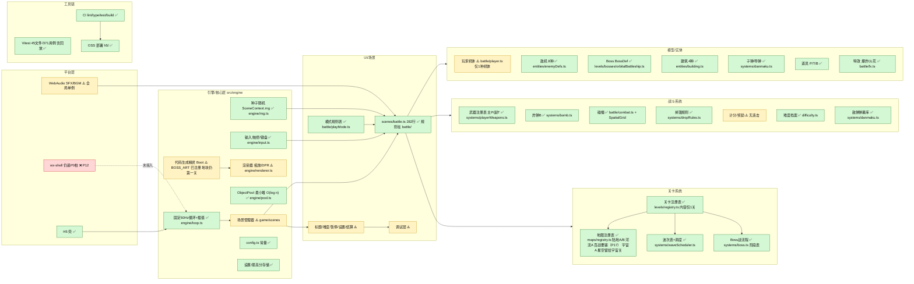
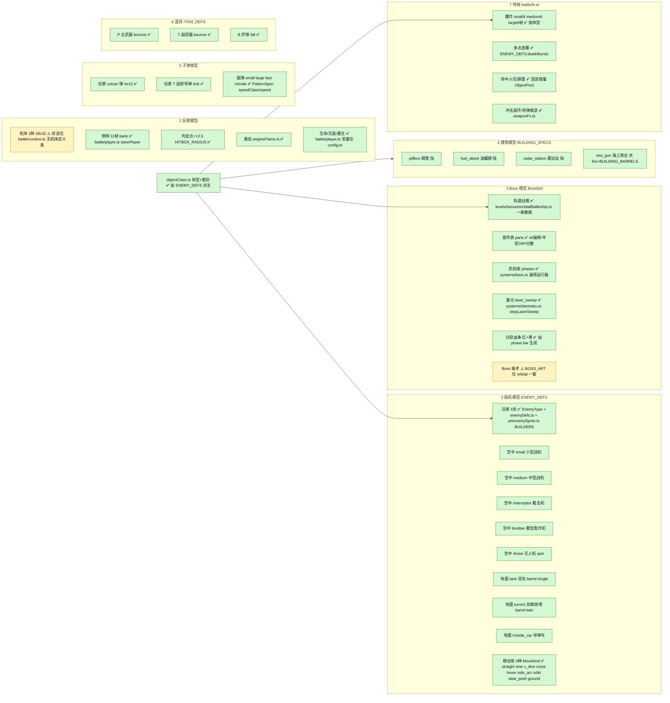
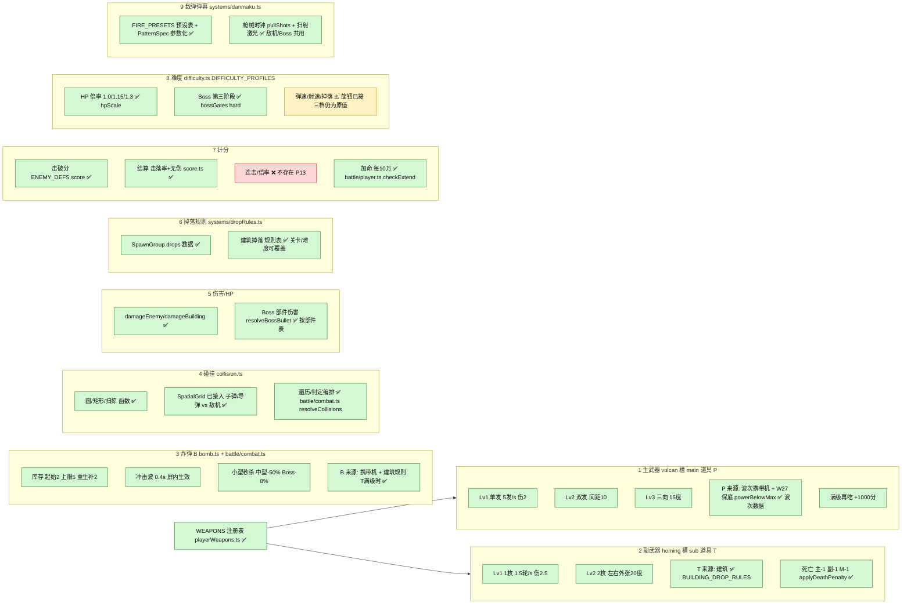
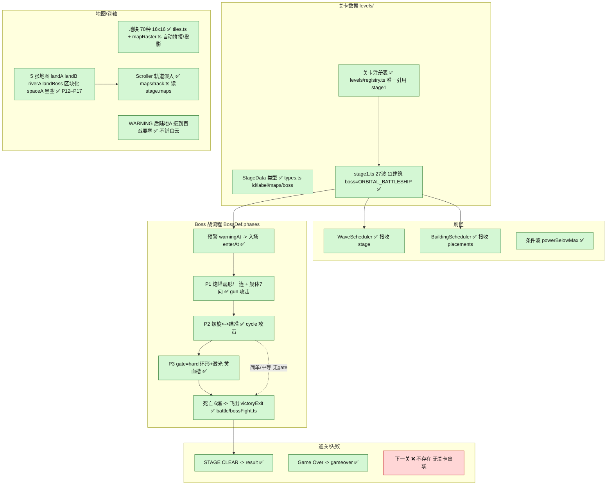
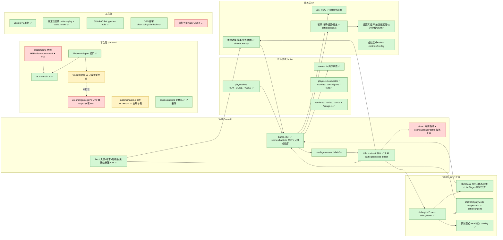

# 电雷 P11 后：架构图

按 `cursor/p11-content-extensible-ea9d` 分支的实际代码重画，结构与 P11 前《架构盘点与 MVP 审查》里的 5 张图一致（1 张总览 + 4 张子图），方便逐项对照。

图例：绿色 `done` = ✅ 已抽象（加内容只改数据 / 注册表）；黄色 `partial` = ⚠️ 部分抽象；红色 `hard` = ❌ 仍硬编码或缺失。路径相对 `src/`（`battle/` 即 `src/game/battle/`）。

5 张图都用 `mmdc`（@mermaid-js/mermaid-cli 12）渲染验证过。

节点统计（5 张合计）：P11 前 ✅69 / ⚠️45 / ❌28（142 个节点），P11 后 ✅128 / ⚠️14 / ❌9（151 个节点，新增了 `battle/` 模块、模式规则表、回放测试等节点）。剩下的 ❌：地块地图只有第一关、下一关串联、标题演示驾驶路线、连击系统、wx-shell 与 `createGame` 的 H5 依赖（P12）、真机性能 / E2E 记录。

## 0 总览

## 1 实体模型（玩家 / 敌机 / Boss / 建筑 / 子弹 / 道具 / 特效）

## 2 战斗系统（主武器 / 副武器 / 炸弹 / 碰撞 / 伤害 / 掉落 / 计分 / 难度 / 弹幕）

P16 僚机 M 不进 `WEAPONS`。等级在 `Loadout.mate`（0 / 1 / 2），开火挂在主炮同一拍上，直线弹伤害锁 `PLAYER_BULLET_DAMAGE`。没有碰撞体。本轮没有掉落。规则在 `systems/mate.ts`。

## 3 关卡与流程

## 4 UI、场景、平台、工具链

