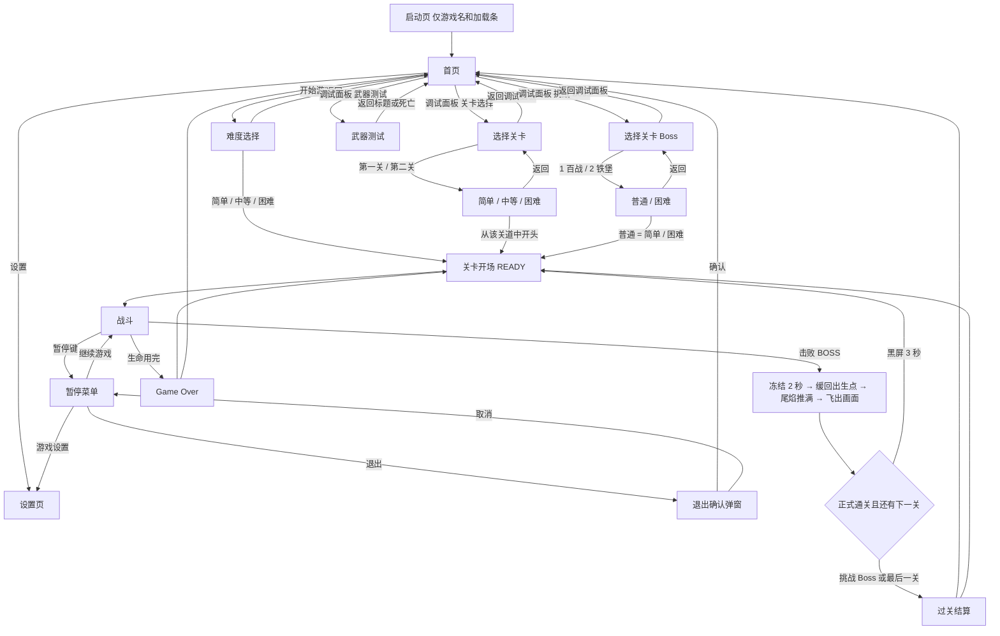

# 《电雷》游戏设计与技术方案 v1.1

> 状态：评审中（2026-10-20）｜上一版：`电雷_设计文档_v1.md`（保留不删）
> 平台：微信小游戏（游戏类目）｜技术：Taro 4 + React 18 + TypeScript + Canvas 2D
> 仓库：先建在开发机上，用 Git/GitHub 管理，部署与同步方式之后再定
> 配套文档：`电雷_第一关波次表_v1.md`（第一关逐波时间轴、敌人数值、掉落与 BOSS 配置）
> 故事：`电雷_故事资产表_v1.md`（五关剧情、旁白与过场的叙事源；不改玩法数值）
> 第二关 Boss：`电雷_第二关_铁堡Boss设计_v1.md`（铁堡 / 弹药转运。P24 已接厂轨和主战。本文 §6.2 仍是第一关百战，铁堡见 §6.2.1 和该专文）
> 第二关道中：`电雷_第二关波次表_v1.md`（v1 已拍板。P28 已按该表实现道中。清波奖励和定点补给机仍不做）

---

## 0. 修订记录

### v1.1 补充（2026-10-25）P28 第二关道中已实现

- **道中**按已拍板的 `电雷_第二关波次表_v1.md` 写入 `stage2.ts`。简单 122 架、中等 159 架、困难 186 架；主炮低于 Lv3 时再加 1 架保底中型。0 个新模型。`rear_diag` 从下缘左右外侧斜向上，内偏约 28°。段落标签 `outskirts` / `runway` / `woods` 只作标注
- **建筑** 10 座，沿用现成掉落。**风险箱**护盾 12、本体 6，时刻按本关空档重排，不复用第一关的 `RISK_CRATE_*` 时钟
- **交接**不动：预警 118 秒，入场 123 秒。不改铁堡。清波奖励和定点补给机仍不做
- **通关衔接**：正式通关第一关后不回标题。结算层改成黑屏 3 秒（`STAGE_CARD_TIME`），写「第二关」和「工业走廊」，然后从道中开头进入第二关。分数、生命、炸弹和武器带过去。挑战 Boss 和最后一关仍进过关结算
- **调试**：面板第一项是「关卡选择」，在「挑战 Boss」之前。选关后再选简单 / 中等 / 困难，从 t = 0 开打，不跳到 Boss。挑战 Boss「2」仍直接进铁堡
- 血量仍乘 1 / 1.15 / 1.30。弹种升级写在波次上，不改 `fireRateScale` / `bulletSpeedScale`

### v1.1 补充（2026-10-25）第二关道中波次 v1 已拍板

- 道中的节奏、波次、侧后斜入、建筑和风险箱时刻写在 `电雷_第二关波次表_v1.md`。Yoan 已拍板：0 新模型、侧后斜入内偏角约 28°、预警 118 秒不动。实现另开 PR，本轮不改 `stage2.ts`。铁堡主战不改 → 该文，本文 §6.2.1

### v1.1 补充（2026-10-25）铁堡挂件跟节，高射扇收到车侧

- **挂件**走岔时车顶炮、核心光贴在所属刚性节上，跟该节同一个平移和转角。直轨不漂。不再按未旋转的 y 去曲线上取屏幕 X → §6.2.1，专文 §5
- **高射扇**五发仍是 60°、间隔 1.4 秒。每一发从该节车体左右边发出（`TIEBAO_SIDE_MUZZLE_X` = 18），顺着车尾的一发留在中线。侧舷扫射用同一对点，不再是 ±34。走岔时枪口跟着该节转角 → §6.2.1，专文 §7.1、§7.4
- **尾灯和剥厢时序**保持上一则：一对尾灯，爆炸帧 0.08 秒，停顿 1.2 秒

### v1.1 补充（2026-10-25）铁堡尾灯只留一对，剥厢爆炸略放慢

- **尾灯**整列只有尾梁贴图里的一对黄灯，贴在当前末节上，走岔时跟那一节一起转。代码不再另画一套。冲轨预告如果亮着，加亮盖在同一对像素上，不另起位置 → §6.2.1，专文 §10
- **剥厢**仍是炸开后车头留在原处，停一下，再按节下滑。剥厢爆炸每帧从 0.06 秒放到 `TIEBAO_SHED_BLAST_FRAME`（0.08 秒），中爆炸 0.36 秒变为 0.48 秒。停顿从 0.9 秒放到 `TIEBAO_SHED_DELAY`（1.2 秒）。中爆炸结束后、开始下滑之前的空档从 0.54 秒变为 0.72 秒。玩家尾焰仍是 `TIEBAO_CHASE_FLAME`（0.35），下滑仍是每节 `TIEBAO_SHED_SLIDE`（0.4 秒） → §6.2.1，专文 §4

### v1.1 补充（2026-10-25）铁堡可见尾段占满走岔

- **并轨**时长不变：邻轨 1.9 秒，左↔右 3.8 秒。9 节车的车头在画面外，走岔的前 `TIEBAO_SWITCH_RUSH`（0.22）只把辙叉送到屏幕上沿，剩下的时间才让可见尾段和道岔走完。无敌仍然只在走岔期间，落稳当帧可以扣血、剥厢 → §6.2.1，专文 §5

### v1.1 补充（2026-10-25）铁堡并轨无敌，武器改绑轨

- **并轨**全程不扣血、不剥厢，开火仍暂停。落稳后再扣血、再剥。剥厢的停顿或下移没结束时，不开始下一次并轨
- **武器**废除全局八式。左轨是侧舷扫射 / 封轨弹墙，中轨是高射扇 / 导弹齐射，右轨是落弹雨 / 冲轨撞击。奇数次停稳打 A，偶数次打 B。开战停在中轨，算第 1 次，打高射扇。只有成功换到某轨才给该轨的次数 +1。三轨火箭和弹链抛射不进战斗。困难过载不看这张表，仍是落弹雨 → 封轨弹墙 → 导弹齐射。冲轨仍要机车 + 4 才真下冲 → §6.2.1，专文 §5、§6

### v1.1 补充（2026-10-24）铁堡并轨加长，剥厢先停再追

- **并轨**输出窗口仍是 4.8 秒。邻轨走岔改为 `TIEBAO_MOVE + TIEBAO_MOVE_EXTRA`（1.2 + 0.7 = 1.9 秒）。左↔右是这段邻轨时长的 2 倍（3.8 秒），不是再加 0.7。跨度 240 / 480 和预铺 64 不改，车仍贴同一条岔股。整列到齐才武器 +1
- **剥厢**血线不变。爆炸当帧裁掉后车，车头留在原处，前面的车厢不马上补进空档。停 `TIEBAO_SHED_DELAY`（0.9 秒），玩家尾焰按 `TIEBAO_CHASE_FLAME`（0.35）略增，停完收回。然后剩余车列用每节 `TIEBAO_SHED_SLIDE`（0.4 秒）下移到原来的歇脚位。死亡、入场和困难第二血直接落终态，不播这段 → §6.2.1，专文 §4、§5

### v1.1 补充（2026-10-24）铁堡直轨不形变，道岔随卷轴留下

- **股道**三条直轨在并轨时也不扭弯、不抽断、不被曲轨盖住改形。岔股是另铺的尖轨、导曲线和辙叉，和车共用 `tiebaoClosureX`
- **道岔**从并轨开始铺下。进行中跟车共用的带子走；换完或取消时钉在当时的世界坐标，之后只跟厂景卷轴向下滚，出了屏幕底再回收。可以同时留着好几段。不淡出。车列仍是整列到齐才武器 +1；死亡和过载取消仍是当帧收直、武器不加 1 → §6.2.1，专文 §5

### v1.1 补充（2026-10-24）铁堡并轨改为刚性分节

- **作废**把整列长贴图切成横条错位（车体被拧成 S 形）。并轨仍是 6 秒里的 1.2 秒，不加时。道岔在车头到达前按 `TIEBAO_SWITCH_LEAD`（64）预铺，和车共用 `tiebaoSwitchX`。车头和每节车厢各自刚性贴切线，转角封顶 `TIEBAO_CAR_MAX_BANK`（25°）。邻轨跨度改为 240，左↔右复式 480。命中是每节一只刚性盒。整列到新轨才武器 +1。死亡和过载取消时尾收近轨、当帧收直、武器不加 1 → §6.2.1，专文 §5

### v1.1 补充（2026-10-24）铁堡换轨改走道岔

- **换轨**仍是停稳到停稳 6 秒（输出 4.8 秒，走岔 1.2 秒），没有轨道高亮。并轨时每节车厢按自己的 y 走尖轨和辙叉，鼻端先上新轨，整列都到了才算换完，然后武器 +1。不再在结束帧把车体 X 从旧轨跳到新轨。当时邻轨跨度 176、左↔右 352，绘制用横条错位。这两档跨度和横条画法已作废，见最上一条。地图上的三条直轨不改。并轨可以受伤，暂停开火。冲轨没回到歇脚点之前不开始并轨 → §6.2.1，专文 §5

### v1.1 补充（2026-10-24）P24 铁堡剥厢，机车加长

- **开战车列**是车头朝上的机车加 9 节细长车厢，命中盒 **80×840**。`parkY` = −260，画面上先是车尾约 2.5 节。主血剩余 90 / 80 / 70 / 60 / 50 / 40 / 30% 各剥 1 节后车（爆炸加碎片），命中盒每次矮 80，尾梁下移 24。≤30% 是机车 + 2 节，**80×280**，鼻在屏幕 y = 48，中心 188。机车段 116（尖头加驾驶室）
- **简单和中等**一条红血打到 0 然后死亡。**困难**第一条血走同一条剥厢曲线；打空后第二条黄血是过载，仍是机车 + 2 节，不再剥厢
- **换轨**当时写成 6 秒、结束时跳到新轨、辙叉只画在背景上。跳轨已经作废，见最上一条。冲轨要到机车 + 4（主血 ≤50%）才下冲，车体下沿到 y = 640，再退回当前节数的歇脚中心 → §6.2.1

### v1.1 补充（2026-10-24）P24 铁堡车厢改成细长

- **车体**仍是车头朝上的一节机车加两节装甲棚车，暂用 A 尖头三节。车身收细，两节车厢大约是宽的两倍长。命中盒改为 **80×232**。`parkY` 改为 164，车头仍停在原来的屏幕高度，多出来的长度在下方。核心 (0, -98)，机车顶炮 (0, -68)，后节顶炮 (0, 74)

### v1.1 补充（2026-10-24）P24 车头朝上，三节棚车

- **车头朝屏幕上方**。玩家从后方追击，精灵顶端是机车鼻，底端是末节尾梁。核心在鼻端，两门车顶炮一在机车顶、一在后节车厢。命中盒后来改成 80×232，见最上一条
- **车体**锁定为深钢色机车加两节装甲棚车，五套只换鼻甲、炮座和顶板：A 尖头三节、B 钝鼻铆甲、C 侧裙弹舱、D 脊炮车顶、E 厚钩尾梁。战斗暂用 A（`TIEBAO_LOOK`）。厂房仍是 A。静帧 `npm run art:tiebao`

### v1.1 补充（2026-10-24）P24 车体重画，厂房选定 A

- **厂房**选定 A 铁皮高窗（`FACTORY_LOOK`）。B–E 仍在绘制器里，战斗不切过去
- **铁堡车体**当时按俯视货车重画，名字后来作废。那一版车头朝屏幕下方，已被上面这一条替换

### v1.1 补充（2026-10-24）P24 试玩：厂房、6 秒换轨、射速、冲轨

- **铁堡厂轨**：接近带下段仍是林地和厂门。过了厂门，以及整个循环段，是满屏厂房：侧墙、高窗、地面和三条无限铁轨（屏幕 X 仍是 72 / 180 / 288）。不铺预警白云，不切宇宙 → §3.7、§6.2.1
- **换轨**：主战和困难过载都是停稳到停稳 6 秒（输出 4.8 秒，并轨 1.2 秒）。没有轨道高亮，也没有「下一轨」提示。并轨时车体沿代码画出的辙叉从旧轨收到新轨，不横跳。过载不再使用更短的时钟；它和主战的差别仍是武器（落弹雨、封轨弹墙、导弹齐射）、烟和坠落弹药箱
- **射速**：除高射扇外，攻击间隔 ×2/3（`TIEBAO_RATE_SCALE`）。高射扇仍是间隔 1.4 秒、首发 0.4 秒
- **冲轨**：进入该式 0.35 秒后，0.12 秒冲到屏幕底沿（车心 y = 560），再用 1.9 秒退回 `parkY`。一个输出窗只冲一次
- **外观未选定**：厂房五套（A 铁皮高窗、B 警示桁架、C 夜班灯带、D 弹药库、E 冷却管廊）和车体五套（A 厢列、B 炮楼头、C 油罐弹舱、D 平板弹架、E 双节堡垒）。战斗暂用 A（`FACTORY_LOOK` / `TIEBAO_LOOK`）。静帧 `npm run art:tiebao`。等挑选，不在这轮锁定

### v1.1 补充（2026-10-24）P24 铁堡主战与厂轨

- **铁堡厂轨** `factoryBoss`：第 2 关 Boss 场。接近带是林地道路进厂门，然后循环三轨厂房（屏幕 X 72 / 180 / 288）。陆地B 末行接到接近带第 0 行（中轴是路、没有水）。不铺预警白云，不切宇宙。室内不设地面云影。地图预览自动多一行「铁堡厂轨」→ §3.7、§7.1
- **铁堡**：弹药转运装甲列车，从中轨开战。换轨 10 秒（预告 1.1 秒、横移 0.8 秒，期间可受伤）。每次换轨成功，武器按高射扇 → 导弹齐射 → 落弹雨 → 侧舷扫射 → 封轨弹墙 → 冲轨撞击 → 三轨火箭 → 弹链抛射前进一式，到头回到第 1 式。主战血 840（两门车顶炮各 140 / 5000，核心 560 / 30000）。困难主战打空后进入过载（额外 240，再乘 1.30），换轨改为 6 秒，武器收成落弹雨、封轨弹墙、导弹齐射。简单和中等核心打掉就死。死亡是多段弹药爆炸，然后走现成通关离场。高射扇第一发在开战 0.4 秒。核心血保持 560，没有改成约 1120 → §6.2.1
- **第 2 关表**仍是空波次、空建筑。`maps.run` 只有陆地B，`maps.boss` 是 `factoryBoss`。预警占位 `STAGE2_WARNING_AT` = 118，入场 `TIEBAO_ENTER_AT` = 123，入场时本地卷轴约 120 像素。调试面板挑战 Boss 多一行「2」。旁白接 `s2_open` / `s2_end`。完整波次表不在本轮

### v1.1 补充（2026-10-24）P23 铁堡 Boss 只定稿

- 第二关 Boss **铁堡**（涂装「弹药转运」）的场地、换轨、武器循环和困难过载写在 `电雷_第二关_铁堡Boss设计_v1.md`。本文 §6.2 仍只描述第一关百战。本轮不改代码、不改数值

### v1.1 补充（2026-10-24）P22 风险箱

- **风险箱** `risk_crate`：扁碟。品红顶盖、黄黑赤道环、青灯、灰金属底；有盾时代码再画青环。护盾 12、本体 6，先打盾。不开火，`hover` 停在 y=160、停 6 秒。小型、空中，炸弹按小型直接击毁（盾和本体一起算）。击毁掉 1 件：僚机为 0 必掉 M（不掷 RNG），否则 M 50% / P 25% / T 25%，不掉 B。不计入 148 架击落率。分数 500。简单 1 个（t=50s，x=180，地面段结束的中段锚点）。中等 2 个（t=50s x=48，t=100s x=312）。困难再加 t=75s x=220。→ §5.6、§6.1、§14.13，波次表 §4.8

### v1.1 补充（2026-10-23）P21a / P21b 轻量：窗口重算缩放，黑边画静态外框

- **缩放**：逻辑分辨率仍是 360×640，不把战场拉宽。窗口缩放、旋转、容器尺寸变化和设备像素比变化时，重算缩放、画布 CSS 尺寸、黑边偏移和 backing store（设备像素比 × 缩放）。靠近整数倍时仍按原规则吸附（小数部分小于 0.2，且至少 1 倍）。最近邻：`imageSmoothingEnabled = false`。触点按新的缩放换回逻辑坐标。iPad 横屏仍是居中的竖屏框，左右留大块边（例如 1024×768 吸附到 1 倍，左右各约 332 CSS 像素；更宽的 1194×834 不吸附，高度铺满、左右仍是大边）→ §3.1
- **外框**：黑边不是纯黑空档。游戏画布后面铺一层不接收点击的静态底：调色板深海色、稀疏星点、上下淡暗角。没有文字，不放摇杆。安全区仍用启动时读到的值 → §3.1

### v1.1 补充（2026-10-23）P20a 建筑按座掉落，M 可以捡

- **建筑掉落**：击毁仍然必掉 1 个，按放置编号，不按种类。B01、B05 固定 T。B06 固定 M。B07 和 B08 每局恰好一座掉 M：进关时用关卡 RNG 掷一次（放置表顺序，`floor(rng × 座数)`，本组先 B07 后 B08），另一座走默认。其余（B02、B03、B04、B09、B10、B11，以及没中 M 的那座海上炮）主炮低于 `POWER_MAX` 时 P / B 各 50%（`BUILDING_DROP_P_SHARE`），主炮已满只掉 B，并且这次不消耗 RNG。放置锁定优先于规则表。关卡或难度仍可换默认规则表。携带机的 P / B 不变。没有风险箱 → §5.6、§6.1.1、§14.10，波次表 §4.7
- **M 道具**：字母 M，16×18 青金翼徽（和 P 的金色导弹、B 的八角、T 的胶囊外形不同）。弹跳和 P / T 一样。拾取后僚机 +1，到 `MATE_MAX_LEVEL` 为止；已满加 `M_OVERFLOW_SCORE`（1000，与满级 P 相同）。P / T 不改僚机。关卡 HUD 在副武器左边画 M 和等级。武器测试仍直接写 `state.mate` → §5.3.2、§5.6、§14.4.2、§14.6

### v1.1 补充（2026-10-23）P19 只留贴边云
- **云**：天空云和地面云影只保留贴着左右边缘、有一部分在画面外的云。从屏幕上方进入的中央车道去掉，地面不留它们的影子。不拉长条、不叠成暗块、不转 90°。陆地 Boss 交接和通关离场不变

### v1.1 补充（2026-10-23）P18 试玩：云有大小和快慢，通关离场放慢
- **云**：仍是那四种紧凑剪影，不拉长条、不叠成暗块、不转 90°。每朵有自己的 `scale` 和 `speed`：大的慢、小的快。横向车道至少隔 8 像素，所以速度不同也不会叠像素。大朵可以故意伸出屏幕左右边缘。地面云影仍是整屏画一遍，卷动是 `CLOUD_SHADOW_SCROLL`（2）再乘自己的速度
- **通关离场**：`systems/victoryExit.ts` 的 `stepVictoryExit` 是唯一一条，正式通关和挑战 Boss、以后的机体都走它。离场一开始就把侧倾收到平飞（`bank` 0、正俯视中间帧），再冻结 2 秒，用 2 秒 smoothstep 缓回出生点，再停 0.85 秒把尾焰从巡航推到满（长度 × `1 + VICTORY_FLAME_BOOST`），然后以 70 像素/秒起步、加速度 220 向上飞出。击破时的倾斜不带进返航和飞出。操作在整段里锁住。结算仍等飞出画面。`VictoryExit.flame`（0–1）交给 `drawEngineFlame`，僚机和以后的机体共用。僚机侧倾用自机当前帧，所以一起回到平飞

### v1.1 补充（2026-10-23）P18 云层与第一关 Boss 接图
- **云**：四种剪影改为紧凑积云（单朵、三瓣、双峰、不规则团块），去掉扁长条和薄卷云。摆放互不重叠。只做上下翻转和左右翻转，不做 90° 旋转。地面云影同样，并且整屏只画一遍，卷动是地面的 2 倍（`CLOUD_SHADOW_SCROLL`），避免粘在地上。星空预警仍用这层；陆地 Boss 交接不画预警云
- **第一关交接**：预警后陆地A 不淡出、不铺白云。百战要塞接在陆地A 末行之后（同一条路的边缘约定），从屏幕上方卷进来。卷轴在 `TILE_HANDOFF_RAMP`（0.5 秒）内升到 `TILE_HANDOFF_PEAK`（280 像素/秒），`TILE_HANDOFF_FAST_END`（4.5 秒）回到 40。Boss 入场时已经在接近带上。挑战 Boss 的 `seek(enterAt)` 直接落在这段上，也不画预警云 → §3.7

### v1.1 补充（2026-10-23）P17 第一关 Boss 场地与旁白条
- **百战要塞** `landBoss`：第一关预警后不再切到宇宙A。预警仍加速、淡出道中、过云层，然后交到一张陆地图：先一卷焦土接近带（公路、崖壁、闸门），再进入上下边相同的要塞庭院并循环。宇宙A 留给真正的宇宙关和地图预览。挑战 Boss 跳到 `enterAt` 时卷轴停在接近带上，并继续以 40 像素/秒卷动 → §3.7、§7.1
- **旁白**：`StageData.captions` 点字幕，文案在 `story/captions.ts`。本轮只接第一关 `s1_open`（开场）和 `s1_end`（Boss 清空后）。条在摇杆上方，`CAPTION_HOLD`（4 秒）后消失，下一条直接换掉上一条。`mid` / `cutscene` 先占位，不画。标题演示不画字幕

### v1.1 补充（2026-10-22）P16 僚机间距与尾焰
- 横向间距收到 25.6（原来 32 的 80%），左右对称。尾焰按缩放后的锚点和宽高贴在僚机尾部，侧倾跟着当前帧的喷口，不再把自机喷口偏移乘 1/3 → §5.3.2、§14.4.2

### v1.1 补充（2026-10-22）P16 M 僚机
- **M 槽**：独立于主武器和副武器，等级 0 / 1 / 2。M=1 在自机左侧挂 1 架僚机，多 1 发直射主炮弹；M=2 左右各 1 架，共多 2 发。僚机用自机同一套精灵，缩放到约 1/3，间距 25.6 像素，同高度，侧倾与自机同步。没有碰撞体。伤害锁在 `PLAYER_BULLET_DAMAGE`，和主炮同一拍开火，不吃 P 的弹道，也不吃 T。死亡降 1 级，可以到 0。本轮没有掉落，武器测试里用 M 的 0 / 1 / 2 调整。正式开局是 0 → §5.3.2、§5.5、§7.1、§14.4.2

### v1.1 补充（2026-10-22）P15 云层四种形、陆地B 成组停机、宇宙A 星球视差
- **云**：预警云层和地面云影共用四种烘焙剪影（扁长积云、鼓包多瓣、薄卷云条、不规则团块）。地面影子用旋转、镜像和两三片堆叠，不每帧重算路径。陆地A、陆地B、河流A 都有云影；宇宙A 没有地面云影 → §3.7
- **陆地B**：停机仍是 45° 的 2×2 地块装饰，没有 HP、碰撞和掉落。改为跑道两侧每组 3 架并排，下一组至少隔 10 行。长度仍是 9 个区块、5760 像素。排水渠和林地小屋保留 → §3.7
- **宇宙A**：原有 3 层星点保留。另加烘焙星球层：贴左边的大行星只露出大约三分之一，另有几颗远处小圆。星球比近景星点慢，大行星又比小行星慢 → §3.7

### v1.1 补充（2026-10-22）P14 陆地B 打磨、海面A 改名河流A、地图预览去掉关卡全程
- **陆地B**：长度仍是 9 个区块、5760 像素、预览 128 秒。停机坪上画 45° 停放的战斗机，是地块装饰，不能打、没有碰撞和掉落。跑道在 `runwayBatteries` 里结束：两侧排水沟汇入一条横向水渠，水渠在区块内部，上下边的五列中轴仍然没有水。最后三个区块是林地：散落小屋和土路、更深的林子、林中废墟（弹坑、残骸、焦树）。林子里没有机库、营房和横贯的公路 → §3.7
- **河流A**：原海面A，id 改为 `riverA`，显示名「河流A」。水道走向不变（左 1–5 / 中 9–13 / 右 17–21，桥在中段，整图一条河）。岸上加村落、水车、农田。第一关仍不用这两张图 → §3.7
- **地图预览**：列表只剩陆地A、陆地B、河流A、宇宙A、返回。没有「第N关全程」

### v1.1 补充（2026-10-22）P13 陆地B、海面A 区块化，启动页只留游戏名
- **陆地B**：军事机场，按陆地A 同一套管线重做。9 个区块、不循环，自下而上是外围（围栏、岗哨、通向跑道的公路、稀疏灌木）→ 机场核心（跑道、机库、塔台、停机坪、油库弹药、防空）→ 战场废墟（弹坑、战壕、残骸、焦树，不切成纯森林）。每个区块上下边有一条五列中轴（第 9–13 列，公路或跑道），边上没有水。360 行 = 5760 像素，地图预览约 128 秒。第一关 `maps.run` 仍是陆地A → §3.7
- **海面A**：内陆水道加林岸，同一长度。水道在区块上下边固定落在左岸（第 1–5 列）、中槽（第 9–13 列）或右岸（第 17–21 列）；湖面只在区块内部变宽。整张图是一条连通水道，没有断头河。码头、桥、炮位占在岸上或水上。第一关仍不用这两张图 → §3.7
- **启动页**：`BOOT_DURATION`（1.5 秒）里只画「电雷」和加载条。没有开始按钮，没有难度层，点按和确认都不进战斗。难度仍在首页点「开始游戏」之后选 → §7

### v1.1 补充（2026-10-22）P12 地图资产化（陆地A）与「地图预览」
- **地图与关卡解绑**：地图是注册表里的资产（地块集、区块库 / 序列、长度、地形掩码），关卡只写「用哪些图、几秒交接」（`StageData.maps`）。原来第一关的三段拆成 4 张图：陆地A（原地面段，重做）、海面A（原海岸段，原样）、陆地B（原基地段，原样）、宇宙A（预警后星空） → §3.7
- **陆地A**：11 个一屏高的区块（9 种 × 2 变体，含小河 / 池塘 / 湖），按种子排出、可镜像，7040 像素（176 秒），第一关预警前全程只用它，不循环。预警 → 云层 → 宇宙A 不变 → §3.7，波次表 §1.1
- **建筑**：11 座全部改到陆地A 上，只改行号，类型、列、编号不变。三座海上炮台在陆地A 的池塘、小河、湖面上，进屏早 0.2 秒；其余时间不变 → §6.1.1，波次表 §4.7
- **地图预览**：调试面板新增「地图预览」，列表是陆地A、陆地B、海面A、宇宙A、第一关全程、返回。只有自机，没有敌人、建筑、波次、BOSS。图走完自动回首页，暂停菜单「返回标题」直接回首页。是一个新的 `playMode: 'mapPreview'`，规则写在 `PLAY_MODE_RULES` → §7.1

### v1.1 补充（2026-10-22）困难 Boss 血条分段，阶段二与阶段三对调
- **血条**：困难的第三段血不再和前两段涂成同一条红。条的总长仍表示炮塔 + 核心 + 阶段三。左边红槽是阶段一和阶段二，右边黄槽是阶段三自己的血，中间一条白分隔。阶段一、阶段二扣血只缩短红槽，黄槽保持满，直到阶段三成为当前目标才往下掉。简单和中等没有黄槽。预警时血条仍从左向右填满，困难会先填红槽再填黄槽 → §6.2，波次表 §4.5 / §5.5
- **阶段对调**：阶段二（简单、中等、困难都打）改为加快后的螺旋和瞄准来回换，没有激光。原来的环形弹、横扫激光、半血加速挪到困难阶段三，打在阶段三自己的那截血上。简单和中等仍然只有两阶段，核心被打掉就死。困难仍是三阶段，核心 30000 分仍在最后一段被打掉时给。阶段三核心发光仍是黄色 → §6.2，波次表 §5.4 / §5.5
- **螺旋加密**：螺旋每 0.12 秒 4 发，飞行 180 像素/秒（原来 0.18 秒 2 发、120 像素/秒）。瞄准三连发间隔 0.75 秒，飞行 228 像素/秒（原来 1.15 秒、152 像素/秒）。每种仍持续 3 秒

### v1.1 补充（2026-10-22）P10.2 挑战 Boss 先选关、再选普通 / 困难
- **挑战 Boss**：调试面板里的入口不变。点下去先出和正式难度层同一套界面的关卡列表，目前只有「1」。选中后再出「普通 / 困难 / 返回」，没有中等。普通等于正式开局的简单（血量 ×1，BOSS 两阶段）。困难等于正式开局的困难（血量 ×1.30，BOSS 第三阶段）。两步都选完才进战斗，仍然跳过道中、直接到该关 Boss。本局记住，不写入设置。从难度返回关卡列表，从关卡列表返回调试面板。这两层打开时标题演示暂停，回到调试面板后继续。正式「开始游戏」的简单 / 中等 / 困难不变 → §7、§7.1

### v1.1 补充（2026-10-22）P10.1 难度、困难第三阶段、通关飞出
- **难度**：首页和启动页点「开始游戏」先出难度层（简单 / 中等 / 困难 / 返回），不直接进战斗。简单是现在这套数值，血量倍率 1。中等所有敌人、建筑、BOSS 部件血量 ×1.15。困难 ×1.30，并且 BOSS 打满现有两阶段后进入第三阶段。倍率是一次乘法（`scaleHp`），不另写一套血量。本局记住（再来一次沿用），不写入设置。难度层打开时标题演示暂停。调试面板「挑战 Boss」不走这三档，见文首 P10.2 → §6.2、§7、§7.1、§14.12
- **通关飞出**：BOSS 死亡动画结束后，自机冻结 2 秒（不吃操作），飞回开场停靠点（`LOGICAL_W / 2`，`PLAYER_SPAWN_Y`），再向上加速飞出画面顶端，然后才进结算。简单 / 中等 / 困难、正式通关和挑战 Boss 走同一条。结算不再由 BOSS 自己在 `clear` 上数 2 秒打开 → §6.2、§7
- **困难第三阶段（方案 E）**：左右炮塔 → 核心这两段不变。核心被打掉后不立刻死，换成自己的一段血（基础 240，再乘困难的 1.30），无敌 1.2 秒，然后在螺旋小弹和瞄准三连发之间来回换，每段 3 秒。不用激光，避免一发秒人。核心的 30000 分在最后一段被打掉时才给。机体仍用阶段二打开的船体，核心发光改成黄色，代码画 → §6.2，波次表 §5.5

### v1.1 补充（2026-10-21）P10 建筑必掉、三档爆炸、加载不画关卡
- **建筑掉落**：击毁必定掉 1 个道具，不再掷 `BUILDING_DROP_CHANCE` / `BUILDING_DROP_B_SHARE`。副武器 T 未满 `HOMING_MAX_LEVEL`（没有副武器、等级 0、或 T 只有 Lv1）只掉 T；T 已经是满级只掉 B。不掉 P。敌机携带机的 P / B 不变。选择函数在击毁当时读 `state.sub`，不用开局时抄下来的一份 → §5.6、§6.1.1、§14.10，波次表 §2 / §4.7
- **爆炸**：小 / 中 / 大各有自己的调色板帧（4 / 6 / 8），经 `renderSprite` 画到离屏 canvas。小型敌人和全部建筑用小爆炸，中型战机、轰炸机、双联炮塔用中爆炸，BOSS 死亡多段爆炸用大爆炸，炮塔脱落用中爆炸。自机死亡仍是 4 帧小爆炸。命中火花画在玩家子弹和追踪导弹打中时，包括没打掉的那一下。爆炸池保持 48，火花单独成池 → §10.3
- **加载**：启动页和任何进首页之前的加载状态不创建、不更新、不绘制标题演示，也不画关卡背景。画面是黑底加启动页自己的字和按钮。演示从首页 `enter` 才开始。从战斗回到首页同样等标题场景进入后再开 → §7、§8

### v1.1 补充（2026-10-21）主炮 P 常驻射速与伤害
- **主炮常驻**：`FIRE_RATE` = 5（每秒轮数，三档一样），`PLAYER_BULLET_DAMAGE` = 2。正式关、Boss 练习、标题演示，以及武器测试进入 / 重置时的 P速 / P伤，都用这两个数。Lv1 / Lv2 / Lv3 全部命中仍是每秒 10 / 20 / 30 点（5×1×2、5×2×2、5×3×2）。BOSS「约 45 秒」的估算不变，因为 Lv3 打单个目标的实际命中仍约每秒 20 点 → §5.3、§14.4，波次表 §2 / §5.2
- **T 钉死为绝对值**：`HOMING_FIRE_RATE` = 1.5，`HOMING_DAMAGE` = 2.5。不再写成 `(FIRE_RATE / 6) * 0.9` 和 `(PLAYER_BULLET_DAMAGE / 2) * 5`。删掉 `HOMING_FIRE_RATE_SCALE`、`HOMING_DAMAGE_FACTOR`。武器测试的 T速 / T伤 进入和重置仍是 1.5 / 2.5 → §5.3.1、§14.4.1

### v1.1 补充（2026-10-21）P9 T 伤害与射速，武器测试可调
- **T 常驻平衡**（当时）：`HOMING_FIRE_RATE = (FIRE_RATE / 6) * 0.9`（约每秒 1.5 轮，在 P7 的 1/6 上减 10%）；`HOMING_DAMAGE = (PLAYER_BULLET_DAMAGE / 2) * 5`（2.5，P7 一半伤害的 5 倍）。主炮当时仍是每秒 10 发、每发 1 点。上面一条把 T 改成绝对值，主炮改成 5 / 2 → §5.3.1、§14.4.1
- **武器测试现场调节**：只在 `playMode: 'weaponTest'` 里多四行，改的是本局一份覆盖值，不改 `WEAPONS`。P速 / P伤是主炮每秒轮数和每发伤害，T速 / T伤是追踪导弹每秒轮数和每发伤害。步进 0.5，显示当前绝对值。进入时等于上面的正式常量。重置把这四项调回去，并清伤害统计；P / T 等级和炸弹存量不动。离开模式同样调回正式常量。炸弹仍是按一下 B 放一颗，没有炸弹射速 → §7.1、§14.11

### v1.1 补充（2026-10-21）P7 体型分级、炸弹重做、主副武器、T 追踪导弹
- **体型分级**：敌人、建筑、BOSS 统一标「小 / 中 / 大」和类别（空中 / 地面 / 建筑 / BOSS），集中定义在 `src/game/entities/objectClass.ts`。以后加新单位只要登记一行 → §5.4.1
- **炸弹**：只打放炸弹那一刻在屏幕内的目标，屏幕外的敌人和建筑不受影响。冲击波圆环从自机扩散，`BOMB_WAVE_TIME`（0.4 秒）扫到最远的屏幕角，圆环扫到谁就结算谁，所以小怪是一串连环爆炸。小型直接击毁（正常得分、掉落、爆炸）；中型扣**最大血量**的 50%（`BOMB_MEDIUM_RATIO`），扣到 0 就正常击毁；BOSS 仍扣 8%。清弹加分、无敌、冷却、闪白不变。**炸弹不再屏震**（以后再考虑，见 §13）。取消 `BOMB_DAMAGE` → §5.4、§14.5
- **武器**：主武器槽和副武器槽同时存在，互不影响。武器统一登记在 `src/game/systems/playerWeapons.ts`（槽位、道具字母和图标、最高等级、每级射速 / 伤害 / 发射函数）。原来的三档主炮就是主武器 P（Lv1–3，弹道不变）。死亡时主武器降 1 级（最低 Lv1），副武器降 1 级，可以降到没有 → §5.3、§5.5
- **T 追踪导弹**：第一种副武器。按住 A 时和主炮一起自动发射。Lv1 每轮 1 发，Lv2 每轮 2 发（最高 Lv2）。P7 射速是当时主炮的 1/6（约每秒 1.67 轮），每发伤害是当时主炮子弹的一半（0.5）。P9 定为每秒 1.5 轮、每发 2.5。主炮后来改成每秒 5 发、每发 2 点，T 钉在 1.5 / 2.5，不再跟着主炮乘。追屏幕内最近的活目标（空中、地面、建筑、BOSS 弱点），转向速度有上限；没目标就直飞向上 → §5.3.1、§14.4.1
- **掉落**（已被 P10 取代）：当时建筑是 30% 掉落，B 和 T 各一半。T 只从建筑掉。波次表里的 P / B 携带机不变。P10 改为击毁必掉一件，见文首

### v1.1 补充（2026-10-21）P8 隐藏调试入口与武器测试
- 首页去掉「挑战 Boss」。菜单只剩「开始游戏」和「设置」
- 设置页去掉「调试模式」。`debugMode` 仍在 `dianlei.settings.v1`，默认关。打开后只画左下角 FPS / 输入 / `getDebugInfo` 叠层，不再绑定任何按键
- 删除 F1 / F2 / F3。不能从战斗里跳到预警或 Boss
- 首页右上角 48×48 热区，2 秒内点满 6 下打开调试面板。超时计数清零。热区外的点击不计，也不清零。演示在面板后面继续跑 → §7.1
- 调试面板：「挑战 Boss」（当时直接进 Boss；P10.2 改为先选关再选普通 / 困难，见文首）、「调试模式」开关、「武器测试」、关闭
- 武器测试是 `playMode: 'weaponTest'`，复用战斗场景的自机、子弹、追踪导弹、碰撞和操作。不卷轴、不排波、不出敌人和建筑。纯色背景，顶部一块固定靶，无限血，只累计子弹和导弹的伤害
- 面板直接改正式装填：P 写入 `state.main`，T 关则 `state.sub = null`，T Lv1/Lv2 是 `{ id: 'homing', level }`，B 写入 `state.bombs`。按住 A 走 `stepFireClock` / `fireVolley`
- 武器测试里 Esc 打开暂停，「返回标题」直接回首页。自机死亡也直接回首页，不进结算、不进 Game Over、不写战报 → §7.1、§14.11

### v1.1 补充（2026-10-21）P6.1 建筑只掉炸弹，演示换路线
- 可破坏建筑击毁后当时是 **30%** 掉一个炸弹（B），不再掉火力道具（P）。P10 改为必掉 T 或 B，见文首 → §6.1.1、§14.10，波次表 §2 / §4.7
- 标题演示每次开始、死亡淡出后重开、或跑满循环重开，从 6 条自动驾驶路线里随机抽一条。路线沿下半屏平滑横移，短暂停、朝缺口躲、并往前方敌人靠。同一路线加同一个种子，摇杆是确定的 → §8

### v1.1 补充（2026-10-21）P6 可破坏建筑
- 第一关加入 4 种可破坏建筑：碉堡、油罐群、雷达站、海上炮台。位置固定写在波次表（地图 + 地图行 + 列），不随机。出场时校验占地：陆上建筑整块压在陆地上，海上炮台整块压在水面上，不压道路和装饰地块 → §6.1.1，波次表 §4.7
- 营房、地堡、机库、雷达装饰地块保持原样，仍然不可破坏
- 血量同小型战机，击毁 500 分。掉落以 P10 为准（必掉 T 或 B）。只有海上炮台开火 → §6.1.1、§14.10

### v1.1 补充（2026-10-21）标题只保留吸引模式
- 去掉晨袭 / 海峡 / 机库三张静帧，以及首页「背景」按钮、设置页「标题背景」和 `titleBackground`。旧存档里的这个字段在读取时丢掉
- 首页是静音的第一关演示。演示就是正式战斗场景：同一套关卡、实体、精灵、地块、弹幕和爆炸。自机按正式规则被击中并爆炸，爆炸结束后画面淡出到黑，再从头循环。演示不写最高分、不改设置。淡出期间标题按钮仍可点。P10：启动页和进首页之前的加载不画这场演示 → §7

### v1.1 补充（2026-10-21）调试模式与标题背景
- 设置页曾增加「调试模式」，**默认关**。关掉时不画左下角 FPS / 调试叠层，F2 / F3 也不跳关。F1 翻转的是这同一项，并写入本地设置。P8 已把入口挪到首页调试面板，并删除 F1 / F2 / F3
- 当时首页可以在第一关演示和三张静帧之间切换。静帧和 `titleBackground` 已由上一条撤销

### v1.1 补充（2026-10-20）P1 试玩后确认
- 第一关 MVP 小型机编队加密约 10%（MVP 敌人 85 → 94），已同步到《第一关波次表》
- 中型战机从 P2 起换成**独立素材**（36×36）；P1 仍是小型战机放大 1.5 倍、换深色调
- 自机保持 28×32
- 新增里程碑 **P1.1：暂停菜单 + 设置页 + 本地存档设置**（原计划在 P3），P2 顺延
- 摇杆默认**动态模式**；静音开关关掉音效和 BGM。BGM 默认关闭，只在设置页开关并调音量，首页和启动页不放音量控件 → §4.1、§8

### v1.1（2026-10-20）根据「待确认问题 缺口一 + 缺口二」答复修订

**素材（S）**
- S1：正式精灵先由**代码逐像素绘制**（尺寸精准、帧一致、可改色），以后可以整批换成画师稿或清理后的生成稿 → §10.1
- S2：确定全部精灵的逻辑像素尺寸 → §10.2
- S3：确定各动画帧数 → §10.3
- S4：锁定 **48 色调色板** → §3.4
- S5：发光（自机光晕、子弹辉光）**由代码叠加**，精灵只画本体 → §3.5
- S6：升级火力**不加挂件外观**，侧倾 11 帧只画一套 → §5.3
- S7：P1 最小可玩先做**小型战机 + 中型战机**；中型先复用小型的素材（放大约 1.5 倍、换深色调、血更厚）→ §6.1、§11
- S8：中文用 **Fusion Pixel Font（OFL 协议）**；「电雷」Logo 画成图片；数字 0–9 单独画 → §3.6
- S9：背景用 **16×16 地块**拼接；风格是**写实一些的像素军事基地**，明亮饱和 → §3.7
- **S10（新增）**：飞机尾部火焰**不画进精灵**，由代码生成（粒子加闪烁）→ §3.5、§10.3

**规则（R）**
- R1：侧倾**平滑优先**：推满 0.2 秒倾到最深，松手 0.15 秒回正，深度跟横向输入成正比，带缓动和死区 → §4.3
- R2：推满时约 1.2 秒横穿屏幕，速度跟推杆幅度成正比 → §4.1
- R3：测试版**一直显示判定点**，做得很淡 → §5.2
- R4：撞到空中敌机会死，地面单位不算 → §5.2
- R5：三档射速相同（每秒 5 发，每发 2 点），伤害靠子弹数量增加；全部命中仍是 Lv1 每秒 10 点、Lv2 每秒 20 点、Lv3 每秒 30 点；用 Lv3 打 BOSS 约 45 秒 → §5.3
- R6：炸弹**无敌 1 秒**（v1 是 2 秒），清掉全部敌弹（换成小分数），小怪直接死，BOSS 掉 8% 血，冷却 1 秒 → §5.4
- R7：死亡后火力降一档，**炸弹重置为 2 颗**；重生后无敌 2 秒，期间整机**半透明、忽隐忽现**，可以射击 → §5.5
- R8：P 道具在屏幕里弹来弹去一会儿再飞走；满火力再吃 P 换分数；炸弹满 5 颗再吃 B 换分数 → §5.6
- R9：**每满 10 万分加一条命**（是否循环用常量控制）→ §5.7
- R10：敌弹速度比街机慢约 20%，同屏敌弹最多 150 颗 → §5.8
- R11：第一关波次表单独成文档 → `电雷_第一关波次表_v1.md`
- R12：计分：小怪 100–300，中型 1000，BOSS 部件 5000，BOSS 本体 30000，关末按击落率和不死另加分 → §5.9

**其他同步修改**
- 新增 §14「可调常量表」，所有数值集中到 `src/game/config.ts`
- 第一关时长从约 2 分 45 秒调整为**约 3 分 25 秒**（道中约 2 分 25 秒，加预警，加约 45 秒 BOSS），详见 §6 和波次表

---

## 1. 项目概述

- **类型**：竖屏、自上而下卷轴的二维像素飞行射击（致敬经典街机，全部原创，不使用「雷电」字样或素材）
- **第一版目标**：一个可以通关的试玩关卡：约 2 分 25 秒道中，加一场约 45 秒的 BOSS 战，全程约 3 分 25 秒
- **发布**：先发微信小游戏，便于分享和快速验证；之后再考虑 App
- **第一版不做**：联网、登录、排行榜、分享战绩卡片、商店和变现、多语言、续关

## 2. 已确认的决策总表

| # | 项目 | 决定 |
|---|---|---|
| 1 | 平台 | 微信小游戏 |
| 2 | 框架 | Taro 4 + React 18 + TS；战斗画面用 Canvas 2D 自研轻量引擎核心 |
| 3 | 操作 | 左手虚拟摇杆，右手 A/B 两个键，所有操作只用这三样 |
| 4 | 关卡 | 第一关是试玩关：约 2 分 25 秒道中，加约 45 秒 BOSS（v1.1） |
| 5 | 像素规格 | 固定逻辑分辨率 360×640，整数倍或等比缩放 |
| 6 | 像素精度 | 现代精致像素（像素画加光影、发光、粒子） |
| 7 | 题材 | 混合：前期地面基地，BOSS 在轨道上 |
| 8 | 色调 | 明亮饱和的街机色；锁定 48 色调色板（v1.1） |
| 9 | 控件布局 | 半透明叠在战场上；透明度和大小可调 |
| 10 | 按键外观 | 简洁扁平的圆形按钮 |
| 11 | A/B 功能 | A 是主炮，按住连射；B 是炸弹，清屏并无敌 1 秒（v1.1） |
| 12 | 打击感 | 标准街机：像素爆炸帧动画、轻微屏震、击中闪白 |
| 13 | 判定 | 只用机身中心的小判定点；测试版一直淡淡地显示（v1.1） |
| 14 | 火力 | 主武器 + 副武器两个槽同时生效（P7）。主武器 P 3 档，吃 P 升级，死亡降一档；三档射速相同，靠子弹数量加伤害（v1.1）。副武器 T 追踪导弹 2 档，死亡降一档，可以降到没有。M 僚机槽 0–2（P16 / P20a），直射基础主炮，无碰撞，道具 M 拾取升级 |
| 15 | 生命 | 初始 3 条命，每满 10 万分加 1 条（v1.1）；不能续关，Game Over 后重开 |
| 16 | 炸弹 | 初始 2 颗，上限 5 颗；只能手动按 B；死亡后重置为 2 颗（v1.1） |
| 17 | 射击 | 按住 A 连射，不做自动射击开关 |
| 18 | BOSS | 简单 / 中等约 45 秒、2 个阶段，左右炮塔可以分别打掉。困难加第三阶段（螺旋 / 瞄准换型）和更高的血量（P10.1） |
| 19 | 音频 | 程序生成的 8-bit 音效，加一条循环 BGM（默认关，可调音量）；不放二进制音乐文件 |
| 20 | 名称 | 《电雷》，标题 Logo 用像素风图片 |
| 21 | 存档 | 只在本地存最高分和设置，不需要服务器 |
| 22 | 分享 | 第一版不做分享卡片（保留微信默认转发） |
| 23 | 正式素材 | 先由代码逐像素绘制，以后可以整批替换（v1.1） |
| 24 | 尾焰与发光 | 由代码实时生成，不画进精灵（v1.1） |

## 3. 视觉规范

### 3.1 镜头与比例
- 用高空、较远的视角，战场要留出足够的躲避空间（参考图：战斗界面 v4）
- 在最初参考图的基础上：视野扩大约 20%，单位先缩小约 10% 再放大约 5%
- 落到代码里是两个参数：`CAMERA_ZOOM`（视野，基准 1.0）和 `SPRITE_SCALE`（单位比例，初始 0.95，即 0.9×1.05），最终在真机上微调
- §10.2 的精灵尺寸是**原始像素尺寸**；画面上的尺寸等于原始尺寸 × `SPRITE_SCALE`。缩放时用最近邻插值，并对齐到整数像素
- 外壳把 360×640 战场 letterbox 在窗口里。缩放、黑边和 backing store 随窗口和旋转重算。黑边是静态外框（深海底、稀疏星点、上下淡暗角），画在战场画布后面，不接收点击。iPad 横屏不改逻辑分辨率，左右留大块外框（P21a / P21b）

### 3.2 敌我区分（硬性规则）

| 元素 | 规则 |
|---|---|
| 玩家机 | 白色加青色机身；青色发光描边由代码叠加；中心有判定点；青色指引箭头只在关卡开场进场时短暂出现 |
| 敌人 | 暗红、深红、黑色系，外圈细红边；地面单位用橄榄色，同样带红边 |
| 玩家子弹 | 细长的青白色激光条，辉光由代码叠加 |
| 敌人子弹 | 带白芯的粉紫色大光球，外圈暗色描边，在任何背景上都要最显眼 |
| 爆炸 | 黄橙色火焰加灰色烟尘，不能用青色或粉紫色 |
| 道具 | 火力画成金色有翼导弹，正中字母 M（方案 B 导弹能量）；炸弹画成蓝钢八角徽章，正中字母 B，顶部有引信火花（方案 B 炸弹能量）；追踪导弹 T 画成竖直的青绿色胶囊（直边圆头、浅绿描边），正中白色字母 T，没有火花和尾翼（P7）。各 2 帧闪烁。主体颜色和敌弹区分开 |
| 追踪导弹 | 4×8 青白小导弹，按飞行方向旋转；尾部橙黄短尾迹由代码画（P7） |
| 尾焰 | 玩家机是青白到淡蓝；敌机是橙黄；都由代码生成 |

### 3.2.1 玩家机动画规则
- **进场箭头**：青色 V 形指引只在关卡开场飞入时出现；玩家拿到控制权后立刻隐藏，游玩中全程不显示。
- **左右倾斜（方案 C，对齐 Raiden MK-II）**：伪 3D 侧倾（绕机身纵轴 roll），机头始终朝上，不做偏航转向。深倾时近侧机翼变大下扫、远侧收成细边，机身脊线始终可见；整机轮廓从平飞时最宽逐渐变窄。精灵条共 11 帧：左倾 5 帧 + 平飞 1 帧 + 右倾 5 帧（可以只画右倾半边，左倾用水平镜像）。不再用左右各 2 帧的旧方案。手感规则见 §4.3。
- **中弹死亡**：玩家机一碰就死，没有血量。中弹瞬间整机闪白 2 帧（约 0.03 秒），接着播放 4 帧黄橙爆炸（不用青色或粉色）。
- **炸弹无敌（1 秒）**：机身外圈加一圈淡青色护盾光，由代码绘制，不闪烁。
- **重生无敌（2 秒）**：整机半透明，忽隐忽现（透明度在 0.25 和 0.9 之间每 0.08 秒切换一次），让玩家清楚感觉到正在无敌。最后 0.5 秒闪得更快（每 0.04 秒切换一次），提示无敌快结束了。
- **尾焰**：不画进精灵，见 §3.5。

### 3.3 HUD
- 顶部细条：分数、最高分、剩余机数图标、炸弹存量（八角 B 图标，有弹的是亮的，空位半透明）、主武器（该武器的道具图标加等级数字，P 是导弹 M 图标）、副武器（在主武器左边：有副武器时是它的道具图标加等级，比如 T 胶囊 + Lv2；没有时显示灰色「SUB -」）；右上角是暂停键
- 顶边距 = 系统安全区顶部 + 4 逻辑像素（`HUD_TOP_PAD`），避开刘海和状态栏
- 字体：数字用单独画的像素数字图；中文用像素字体（§3.6）

### 3.4 调色板（S4：锁定 48 色）
所有正式精灵和地块只用这 48 种颜色。调色板放在 `src/game/assets/palette.ts`，绘制精灵的代码按编号取色。代码叠加的发光和粒子可以用半透明，不受这个限制。

| 色组 | 数量 | 用途 |
|---|---|---|
| 中性色（黑、灰、白） | 8 | 描边、高光、烟尘、金属 |
| 玩家（白、青、淡蓝） | 6 | 机身、座舱、激光 |
| 敌方空军（暗红、深红、黑红） | 6 | 敌机机身、红边 |
| 地面单位（橄榄、土黄） | 5 | 坦克、炮塔、导弹车 |
| 地形（草绿、深绿、土褐、沥青、混凝土） | 10 | 地块 |
| 水域（深蓝、浅蓝、浪白） | 5 | 河流、海岸 |
| 爆炸（黄、橙、红橙） | 4 | 爆炸、尾焰、警示灯 |
| 敌弹（粉紫、品红、白芯） | 4 | 敌人子弹 |
| **合计** | **48** | |

### 3.5 代码生成的效果（S5 + S10）
- **发光**：自机青色光晕、玩家子弹辉光、敌弹外圈辉光、BOSS 核心发光，都在精灵上面用代码叠加（加色混合或半透明圆），强度和呼吸节奏可以调。精灵本身只画本体。
- **尾焰（S10）**：所有飞机（玩家和空中敌机）的尾焰都不画进精灵。
  - 玩家：机尾挂 1–2 个喷口挂点，每帧画一个长度随机抖动的火焰（长 6–10 像素，宽 3–4 像素，青白芯加淡蓝外层），同时少量向下飘的粒子（每秒约 20 个，寿命 0.15 秒）
  - 侧倾时喷口挂点跟着帧变化（每个侧倾帧记录挂点偏移）
  - 向上飞时尾焰略长，向下飞时略短
  - 敌机：尾焰朝上，橙黄色，长度是玩家的一半左右，不加粒子，以省性能
  - 追踪导弹：喷口 1 个闪烁黄像素，加最近 4 个位置的橙色淡出尾迹（P7）
- **炸弹冲击波（P7）**：从自机向外扩散的像素圆环，2×2 像素块拼成，外到内是白、淡青、青三层，最后 30% 时间淡出。不画进精灵
- 因为尾焰和发光都交给代码，精灵帧数更少，包体更小，还可以统一调整。

### 3.6 字体（S8）
- **中文**：Fusion Pixel Font（OFL 1.1 协议，可以商用；发布时附上协议文本）。只打包第一版实际用到的字（按文案表裁剪子集），控制包体
- **Logo「电雷」**：手绘像素图片，首页和启动页共用
- **数字 0–9**：单独画的像素数字图（分数、倒计时），等宽，字形 8×12 像素
- 英文提示（READY、WARNING、STAGE CLEAR）：画成图片，或用同一款像素字体的英文部分

### 3.7 背景（S9）
- 用 16×16 地块拼地图。屏幕宽 360 = 22.5 块，地图宽做 23 块（368 像素），居中裁掉两边各 4 像素
- 风格：写实一些的像素军事基地（跑道、机库、掩体、公路、海岸防波堤），明亮饱和，不能比敌弹更抢眼（背景饱和度和明度整体压低一档，确保粉紫敌弹最醒目）
- **地图与关卡解绑（P12，P17 改 Boss 场地）**：地图是资产，在 `src/game/maps/registry.ts` 注册（地块集、区块库 / 序列、长度、地形掩码、可选的 `loopFrom`）。关卡用 `StageData.maps` 写「用哪几张图、几秒交接」。`boss` 是一张带循环行的地块场，或真正宇宙关才用的星空。多张图交接时提前 1 秒开始卷动，用 1 + 2 秒交叉淡入
- 现有 6 张图：**陆地A**（草地、农田、村庄、森林、小河和湖，P12）、**陆地B**（军事机场：外围 → 跑道 → 尽头排水 → 林地，P14；停机成组，P15）、**河流A**（一条河、桥、岸边村落，P14；原海面A）、**百战要塞**（第一关 Boss 场，P17：接近带 + 可循环庭院，复用陆地地块，没有水）、**铁堡厂轨**（第二关 Boss 场，P24：接近带前段是林地和厂门，过了厂门和整个循环段是满屏三轨厂房，屏幕 X 72 / 180 / 288，没有水，不设地面云影。厂房外观已选定 A 铁皮高窗）、**宇宙A**（星空，P15 加贴边大行星和远处小行星；留给以后的宇宙关和地图预览）
- 第一关预警前全程只用陆地A（7040 像素，176 秒的量，不循环）。预警后地面保持不透明，百战要塞接在陆地A 最后一行之后卷进来（接近带底边和陆地A 顶边都是第 11 列的路、没有水），不铺预警白云，也不切宇宙。卷轴先升到 280 像素/秒，4.5 秒后回到 40，Boss 入场时人已经在接近带上，再进入庭院循环。第 2 关的表是陆地B（5760 像素，9 个区块），道中波次和 10 座建筑已按第二关波次表填上；预警后铁堡厂轨接在陆地B 最后一行之后，接法与百战要塞相同（`STAGE2_WARNING_AT` = 118，入场 `TIEBAO_ENTER_AT` = 123，入场时本地卷轴约 120 像素）。河流A 仍是 5760 像素，只在地图预览里。不要把第一关 `maps.boss` 指回宇宙A，也不要把第一关指到铁堡厂轨
- 三张地块图都用区块拼：每个区块 40 行（一屏高），代码按种子画出 16×16 地块。陆地A 的边缘接口是主路第 11 列，小河从左侧、右侧或中槽穿过或不穿过。陆地B 的上下边是五列中轴（第 9–13 列的公路或跑道），边上没有水；跑道尽头的排水渠在区块内部。河流A 的上下边是五列水道（左岸、中槽或右岸），湖面不碰到边缘行。停机的飞机、水车、小屋是地块，不是敌人。陆地B 的飞机在跑道两侧停机坪上成组并排（每组 3 架 2×2 相接，约 45°），组与组之间至少空 10 行。光从左上来，树、房屋、岩石向右下投 3 像素影子。陆地A、陆地B、河流A 和百战要塞都有半透明云影。铁堡厂轨在室内，不设地面云影。有云影的图用四种烘焙剪影（单朵积云、三瓣积云、双峰积云、不规则团块）。只摆贴着左右边缘、至少有一部分在画面外的云，不放从屏幕上方进入的中央车道；地面云影同一条，不给删掉的云留影子。不叠成暗块，只做上下或左右翻转，开机烘焙，不每帧重算路径。整屏只画一遍云影。星空预警用同一套贴边云；陆地 Boss 交接不画这层
- 每个区块只烘焙一次到 368×640 的离屏画布，放进 4 张的 LRU。每帧只画屏幕上的 2 个区块，下一块分帧预烘（每帧 4 行地块）。陆地B、河流A 走同一条，不另开整图烘焙
- 地形掩码：每种地块是 land / water / feature 之一（`maps/terrain.ts`）。建筑、坦克和测试都读掩码，不直接认地块编号。焦土、弹坑、焦树是 land，战壕、残骸、停机飞机、水车、茅屋是 feature。新地图的作者守则见 `docs/电雷_P12_地图资产说明.md`
- 卷轴速度 `BG_SCROLL_SPEED` = 40 像素/秒，方向是**从上到下**：新地形从屏幕上方进入，已经走过的地形向屏幕下方移出。玩家在下方，感觉是向前飞。地面敌人跟着背景一起向下移动
- 地图像素不上下颠倒。逻辑第 0 行画在位图底部、每块地仍然正放；卷动增大时取样窗口往位图上方走，屏幕上的地块就向下滑
- 地图数据用二维编号数组，由区块生成器产出；之后可以换成编辑器导出

## 4. 操作设计

### 4.1 左摇杆
- **固定模式**：摇杆一直显示在左下角的固定位置
- **动态模式**（默认）：手指按在左半屏任意位置时，摇杆在按下处出现；松手后淡到约 30% 透明度，停在最后的位置
- 摇杆最大半径 `JOYSTICK_RADIUS` = 56 逻辑像素；死区 `JOYSTICK_DEADZONE` = 推杆幅度的 12%，死区内算没推
- **移动速度（R2）**：速度跟推杆幅度成正比（死区外线性映射到 0–1）。推满时速度 `PLAYER_SPEED` = 280 像素/秒，约 1.2 秒横穿屏幕。不另外做「精确移动」；预留常量 `JOYSTICK_CURVE`（默认 1.0 表示线性，调大以后轻推更慢）
- 斜向推满时不超过最大速度（向量长度截断到 1）
- 支持多点触控：摇杆和 A/B 可以同时按，各自按 `touch identifier` 跟踪

### 4.2 右侧 A/B 键
- A：主炮，按住连射，每秒 5 发（三档都一样）
- B：炸弹，手动触发；效果见 §5.4
- 尺寸（控件大小 100% 时）：A 直径 68 逻辑像素，B 直径 56 逻辑像素；控件大小滑块范围 80%–130%
- 状态：常态、按下（变暗加缩小 4%），B 没有炸弹或在冷却时显示为灰色
- 布局有两种：A 高 B 低，或 A 低 B 高（默认 A 低 B 高，和参考图一致）
- 边距：底边距 = 系统安全区底部 + 12（`CONTROL_BOTTOM_PAD`），左右边距 16（`CONTROL_SIDE_PAD`）

### 4.3 侧倾手感（R1：平滑优先）
用一个连续的倾斜值 `bank`（−1 表示最深左倾，0 表示平飞，+1 表示最深右倾）驱动 11 帧精灵：

1. **目标值**：`target = 横向输入 x`（摇杆横向分量，−1 到 1）。`|x| < BANK_DEADZONE`（0.10）时，目标为 0（轻微抖动不会触发侧倾）
2. **趋近**：每帧让 `bank` 向 `target` 移动
   - 加深倾斜（`|target| > |bank|`，同方向）：速度 = 1 / `BANK_IN_TIME`（0.20 秒从 0 到 ±1）
   - 回正或反向：速度 = 1 / `BANK_OUT_TIME`（0.15 秒从 ±1 到 0）
3. **缓动**：用 `easeOutQuad` 把 `bank` 映射到显示值，开头快、末尾慢，看起来更顺
4. **选帧**：`frame = round(display × 5) + 5`，取值 0–10（0 = 最深左倾，5 = 平飞，10 = 最深右倾）
5. **防抖**：帧编号只在 `display` 越过两帧分界 ±0.04 后才切换，避免在边界上来回跳帧
6. 推一半只倾一半（成正比）；动态摇杆松手时按回正速度回到平飞
7. 侧倾只影响画面，不改变判定点位置和移动速度

## 5. 玩法规则

### 5.1 总览

| 项目 | 规则 |
|---|---|
| 生命 | 初始 3 条，最多 5 条；每满 10 万分加 1 条 |
| 判定 | 中心圆形，半径 2.5 逻辑像素；敌人用矩形或圆形判定 |
| 火力 | 主武器槽 + 副武器槽同时生效。主武器 P 3 档，三档射速相同，靠子弹数量加伤害；副武器 T 2 档。另有 M 僚机槽 0–2（§5.3.2）。死亡各降一档，副武器和 M 可以降到没有 |
| 炸弹 | 初始 2 颗，上限 5 颗；死亡后重置为 2 颗；只打屏幕内，按体型结算（§5.4） |
| 道具 | P 和 B 由指定的「携带机」掉落（见波次表）；建筑击毁必掉 1 个，按放置编号：B01/B05 掉 T，B06 掉 M，B07/B08 每局恰好一座掉 M，其余 P/B 各半（主炮满级只掉 B）（§6.1.1） |
| 计分 | 见 §5.9 |
| 失败 | 生命用完就 Game Over，可以重开或回首页 |

### 5.2 判定与碰撞（R3 / R4）
- 玩家判定点：机身中心半径 2.5 像素的圆。只有判定点碰到敌弹、激光或空中敌机才算中弹。僚机没有判定，敌弹和敌机穿过僚机，也不挡自机（§5.3.2）
- **测试版一直显示判定点**：白芯加淡青色细圈，整体透明度 0.45，不刺眼。以后正式版可以加开关（常量 `SHOW_HITBOX`）
- **撞机（R4）**：玩家判定点碰到**空中敌机**（含 BOSS 机体）就死；地面单位（坦克、炮塔、导弹车）可以从上面飞过，不算撞机。撞机时敌机本身不受伤
- 玩家子弹打敌人：用敌人的矩形或圆形判定
- 粗筛用空间网格（格子 64×64），再精确判定

### 5.3 火力（R5 + S6）

| 档位 | 子弹 | 每秒伤害（全部命中） |
|---|---|---|
| Lv1 | 1 道直射激光 | 10 |
| Lv2 | 2 道平行激光（间距 10 像素） | 20 |
| Lv3 | 中间 1 道，加左右各 1 道 15° 斜射 | 30（BOSS 战实际约 20） |

- 射速 `FIRE_RATE` = 每秒 5 发，三档一样；每颗子弹伤害 2；子弹速度 720 像素/秒；子弹尺寸 4×12
- 第一次按下 A 立刻发射，之后按射速连发
- 升到 Lv2 / Lv3 **不加挂件外观**（S6），自机精灵不变，只是子弹变多
- 上表的每秒伤害是「每秒轮数 × 每轮子弹数 × 每发伤害」。射速从 10 改成 5、每发从 1 改成 2 之后，三档全部命中仍是 10 / 20 / 30，因为每轮子弹数没变
- BOSS 总血量按「Lv3 实际约 20 伤害/秒、打约 45 秒」设计，见波次表 §5。斜射经常打不中单个目标，所以实际约 20 而不是表上的 30；这个命中比例不随单发伤害变化，45 秒估算仍然成立。副武器的额外伤害没有算进这个估算。每发变成 2 点之后，840 点的 BOSS 血量上几乎没有溢出

**主武器与副武器（P7）**
- 自机同时带一把主武器和最多一把副武器，两个槽互不影响。按住 A 时两把一起开火，各自按自己的射速计时
- 每把武器在 `src/game/systems/playerWeapons.ts` 里登记一份定义：编号、槽位（`main` / `sub`）、道具字母（同时决定道具精灵和 HUD 图标）、最高等级、满级再吃的加分、每级的射速 / 伤害 / 发射函数。道具也按表驱动（`ITEM_DEFS`、`ITEM_PIXELS`）。以后加一把新武器，就是加一份定义、一个道具字母和一个图标
- 现有武器：主武器 P（vulcan，Lv1–3，就是上表的三档主炮）；副武器 T（homing，Lv1–2，§5.3.1）
- 吃武器道具：
  - 和该槽当前武器相同：升 1 级，到该武器最高级为止；已满级就加 1000 分（`P_OVERFLOW_SCORE`，P 和 T 一样）
  - 同槽的另一把武器（以后才会有）：换成新武器，等级保留，超过新武器上限就压到上限
  - 副武器槽空着：装上，Lv1
- 调试面板「挑战 Boss」：主武器直接满级（`maxOut(state.main)`），副武器为空
- 标题演示走同一套武器代码，没有演示专用的武器逻辑

### 5.3.1 T 追踪导弹（P7，第一种副武器）
| 等级 | 每轮导弹 | 每秒伤害（全部命中） |
|---|---|---|
| Lv1 | 1 发，从机头正上方直射发出 | 3.75 |
| Lv2 | 2 发，从左右翼（±8 像素）各向外偏 20° 发出 | 7.5 |

- 射速 `HOMING_FIRE_RATE` = 1.5（每秒轮数，绝对值）。P9 在当时主炮每秒 10 发的 1/6 上减 10% 得到这个数；主炮改成每秒 5 发之后，T 不再跟着乘
- 每发伤害 `HOMING_DAMAGE` = 2.5（绝对值）。P9 把当时「主炮子弹的一半」（0.5）乘 5 得到这个数；主炮改成每发 2 点之后，T 不再跟着乘
- 没有改 BOSS 血量。§5.3 里「打约 45 秒」的估算仍然只算主炮，不算副武器
- 追踪：每帧锁定离导弹最近的、屏幕内的活目标：空中敌人、地面敌人、完好建筑、BOSS 当前能打的弱点（入场和阶段切换的无敌期不锁）。转向速度最多 `HOMING_TURN_RATE`（270°/秒），飞行速度 `HOMING_SPEED`（330 像素/秒），所以路线是自然的弧线。没目标时转回正上方直飞
- 命中判定是 6×6 的小方块（`HOMING_HIT_SIZE`），和玩家子弹打同样的目标；打 BOSS 的规则和子弹一样（舰首记到最近弱点，装甲挡住不扣血）
- 飞出屏幕或飞满 `HOMING_LIFETIME`（2.5 秒）就消失，不会一直绕圈。导弹用对象池
- 外观：4×8 青白小导弹，按方向旋转；短尾迹由代码画（§3.5）

### 5.3.2 M 僚机（P16）

M 是独立槽，不写进 `WEAPONS`。等级 0 / 1 / 2，上限 `MATE_MAX_LEVEL`。正式开局、Boss 练习和标题演示都是 0。道具 M 拾取后 +1，已满加 `M_OVERFLOW_SCORE`（1000）。P / T 不改这一槽。武器测试仍可以直接写成 0 / 1 / 2。

| 等级 | 僚机 | 每轮额外子弹 |
|---|---|---|
| 0 | 没有 | 0 |
| 1 | 自机左侧 1 架 | 1 发直射 |
| 2 | 左右各 1 架 | 2 发直射 |

- 僚机用自机同一套 11 帧侧倾精灵，缩放到约 1/3（`MATE_SCALE`）。取整后大约 9×11。左右间距 `MATE_OFFSET_X` = 25.6（原 32 的 80%），高度与自机中心相同（`MATE_OFFSET_Y` = 0）。侧倾用自机当前那一帧，位置每帧跟自机中心走
- 没有碰撞体。不挡敌弹，不会被打掉，不撞敌机，也不挡自机。判定仍只有自机中心那个圆
- 只打直射主炮弹，和主炮是同一种玩家子弹。主炮那一轮开火时一起打，包括武器测试里改过的 P速。每发伤害锁在 `PLAYER_BULLET_DAMAGE`（2），不跟着 P 的等级、扩散和多弹道，也不吃武器测试的 P伤。不发射 T，火力形态不升级
- 吃 P / T 只改自机。吃 M 只加僚机等级。死亡时 M 降 1 级（`DEATH_MATE_LOSS`），可以降到 0
- 尾焰由代码画，贴在缩放后的机尾。喷口按这一帧的锚点，再用绘制宽高换算，不把自机喷口偏移乘 `MATE_SCALE`。侧倾时喷口跟着当前帧移动，火焰仍在僚机尾部中心
- 关卡 HUD 在副武器图标左边画 M 和等级（0 级变淡）。武器测试面板仍显示僚机等级，并用 0 / 1 / 2 直接写入

### 5.4 炸弹（R6，P7 重做）
- 按 B 立刻生效；需要还有炸弹，并且不在冷却中（冷却 `BOMB_COOLDOWN` = 1 秒）
- 无敌 `BOMB_INVINCIBLE_TIME` = **1 秒**（v1 是 2 秒）
- 清掉全屏所有敌弹（包括导弹），每清掉 1 颗得 10 分（`BOMB_BULLET_SCORE`），并飘出很小的分数字
- **只打放炸弹那一刻在屏幕内的目标**（身体有任何一部分在 360×640 里就算）。屏幕外的敌人和建筑完全不受影响，比如刚在屏幕上方生成、还没进屏的编队
- 按体型结算（§5.4.1）：
  - 小型：直接击毁，正常得分、掉落、爆炸、计入击落
  - 中型：扣**最大血量**的 50%（`BOMB_MEDIUM_RATIO`）。剩余血量不够扣就正常击毁。满血的中型吃两颗炸弹才死
  - BOSS（大型）：扣 BOSS 总血量的 8%（`BOMB_BOSS_RATIO`）。阶段一由还活着的炮塔平分，阶段二全部算到核心；BOSS 入场和阶段切换时的无敌期不扣血。BOSS 立刻结算，不等圆环
- **冲击波**：从放炸弹时自机的位置扩散一个像素圆环（§3.5），`BOMB_WAVE_TIME`（0.4 秒）扫到离自机最远的屏幕角。每个目标在圆环扫到它时才结算，所以小怪是一串由近到远的连环爆炸，整串不超过 0.4 秒。等圆环的这段时间里，被标记的敌人不再开火
- 正在激光蓄力或发射时放炸弹：激光立刻中断，并重新计算激光冷却
- 白色闪屏 0.15 秒（`BOMB_FLASH_TIME`）
- **不屏震**（P7 去掉）。以后要不要加炸弹屏震另议，见 §13
- 重生无敌期间也可以放炸弹

### 5.4.1 体型分级（P7）
敌人、建筑、BOSS 共用一张表（`src/game/entities/objectClass.ts`），每种单位登记「体型 + 类别」。炸弹按体型结算，追踪导弹按类别找目标。以后的新单位（包括小 BOSS）只要在表里加一行。

| 体型 | 单位 | 类别 |
|---|---|---|
| 小 `small` | 小型战机、无人机、拦截机、风险箱 | 空中 |
| 小 `small` | 坦克、导弹车 | 地面 |
| 小 `small` | 碉堡、油罐群、雷达站、海上炮台（所有建筑） | 建筑 |
| 中 `medium` | 中型战机、重型轰炸机；以后的小 BOSS | 空中 |
| 中 `medium` | 双联炮塔 | 地面 |
| 大 `large` | BOSS | BOSS |

### 5.5 死亡与重生（R7）
1. 中弹：闪白 2 帧，播放 4 帧爆炸，中等屏震；同时清掉屏幕上所有敌弹（不加分），给玩家喘口气
2. 结算惩罚：主武器降一档（最低 Lv1）；副武器降一档，Lv1 再降就没有了（`DEATH_SUB_LOSS`）；M 僚机降一档，可以降到 0（`DEATH_MATE_LOSS`）；**炸弹重置为 2 颗**（不管原来有几颗，多的作废，少的补到 2）；生命 −1
3. 1 秒后（`RESPAWN_DELAY`），玩家机从屏幕下方外面飞到 y = 560，用时 0.5 秒，这段时间不能操作
4. 拿回控制权后开始 2 秒无敌（`RESPAWN_INVINCIBLE_TIME`），期间整机半透明、忽隐忽现（§3.2.1）；**可以射击，也可以放炸弹**
5. 第一版死亡时不掉落道具
6. 生命为 0 时不再重生，2 秒后进入 Game Over

### 5.6 道具（R8）
- **P（火力）**：从携带机的位置出现，以 70 像素/秒斜向飞行，碰到屏幕左右边和上边就反弹（不碰下边），在屏幕里弹 8 秒后从最近的边飞出去。最后 2 秒闪得更快作为提示
- **B（炸弹）**：从携带机的位置出现，以 45 像素/秒慢慢往下落，左右轻轻摆动，掉出屏幕底部就消失
- **T（追踪导弹，P7 / P10 / P20a）**：第一关只从 B01 和 B05 固定掉。和 P 一样弹来弹去 8 秒后飞走。规则见 §5.3、§6.1.1
- **M（僚机，P20a）**：第一关 B06 固定掉，B07 与 B08 每局恰好再掉一个。外形是青金翼徽，弹跳和 P / T 一样。拾取 +1 级，满级再吃加 1000 分（`M_OVERFLOW_SCORE`）
- **风险箱（P22）**：打掉再掉 1 件，走同一套 M / P / T 道具。僚机等级为 0 时必掉 M，不掷 RNG；否则 M 50% / P 25% / T 25%。不掉 B。见 §6.1、波次表 §4.8
- 拾取范围：道具中心到自机中心不超过 14 像素（比判定点大很多，方便吃）
- 满火力（Lv3）再吃 P：得 1000 分（`P_OVERFLOW_SCORE`）；T 满级（Lv2）再吃 T 也是 1000 分；僚机已满再吃 M 也是 1000 分（`M_OVERFLOW_SCORE`）
- 炸弹满 5 颗再吃 B：得 2000 分（`B_OVERFLOW_SCORE`）
- 1UP 道具第一版不放（加命只靠分数）；素材可以先留
- 道具不会被敌弹或炸弹打掉

### 5.7 加命（R9）
- 每满 10 万分加 1 条命（10 万、20 万、30 万……），用常量 `EXTEND_EVERY = 100000`、`EXTEND_REPEAT = true` 控制；想改成只在 10 万分加一次，把 `EXTEND_REPEAT` 设成 `false` 就行
- 生命上限 5 条（`LIVES_MAX`）；已满时再达到加命分数，改为得 5000 分
- 加命时播放提示音，并在 HUD 机数旁闪一下「1UP」
- 按第一关的数值，打得好的玩家大约在 BOSS 战末段或关末结算时达到 10 万分

### 5.8 敌弹（R10）
- 敌弹速度 = 街机基准速度 × 0.8（`ENEMY_BULLET_SPEED_SCALE`）

| 敌弹 | 尺寸 | 基准速度 | 实际速度 |
|---|---|---|---|
| 小弹（瞄准弹、扇形弹） | 6×6 | 150 | 120 像素/秒 |
| 大光球（环形弹、BOSS） | 12×12 | 125 | 100 像素/秒 |
| 快弹（困难阶段三环形弹空档的瞄准） | 6×6 | 190 | 152 像素/秒 |
| 阶段二螺旋小弹 | 6×6 | — | 180 像素/秒（`BOSS_PHASE3_SPIRAL_SPEED`，不走上面的 120） |
| 阶段二瞄准三连发 | 6×6 | — | 228 像素/秒（`BOSS_PHASE3_AIMED_SPEED`，不走上面的 152） |
| 追踪导弹 | 6×12 | 110 | 88 像素/秒（追踪 1.2 秒后直飞） |

- 同屏敌弹上限 `ENEMY_BULLET_CAP` = 150 颗；满了以后新敌弹不再生成（不删旧的），并在调试面板里计数
- 敌弹判定半径比画面小一点：小弹 2 像素，大光球 4 像素（街机惯例，对玩家友好）
- 敌人只在屏幕内（y ≥ 8）开火；离玩家很近（距离 < 48 像素）时不发瞄准弹，避免贴脸秒杀

### 5.9 计分（R12）

| 对象 | 分数 |
|---|---|
| 小型战机 | 100 |
| 拦截机 / 坦克 | 200 |
| 旋转无人机 / 导弹车 | 300 |
| 中型战机 / 双联炮塔 | 1000 |
| 重型轰炸机 | 2000（体型大、血多，比中型高一档；属于本版假设） |
| 风险箱 | 500（与建筑相同；奖励主要是掉落） |
| BOSS 左/右炮塔（部件） | 各 5000 |
| BOSS 核心（本体） | 30000 |
| 炸弹清掉的敌弹 | 每颗 10 |
| 满火力吃 P、满级吃 T / 满炸弹吃 B | 1000 / 2000 |

**关末奖励**
- 击落率奖励 = 击落率百分比（取整）× 200，击落率 100% 时再加 10000（满分 30000）
- 不死奖励：整关没死过，加 30000
- 击落率 = 击落数 / 实际出场的敌人数（条件波次没出场的不算）

## 6. 第一关：试玩关（约 3 分 25 秒）

逐波细节（时间、敌人、位置、移动、弹幕、血量、掉落、BOSS 配置）见 **`电雷_第一关波次表_v1.md`**。下表是总览：

| 时间 | 段落 | 内容 |
|---|---|---|
| 0:00–0:05 | 开场 | 「STAGE 1」和 READY 提示，玩家机飞入，进场箭头 |
| 0:05–0:50 | 地面段 | 教学节奏：小型战机编队、第一架中型战机（0:20 掉第一个 P）、少量坦克和炮塔 |
| 0:50–1:35 | 海岸段 | 中型战机（0:52 掉第二个 P）、无人机、第一个 B（约 1:02）、轰炸机 |
| 1:35–2:30 | 基地段 | 炮台群、导弹车、密集编队；P 和 B 补给；2:28 视情况保底补 P |
| 2:30–2:35 | 预警 | 停止刷怪，WARNING，BOSS 血条出现。地面加速，陆地A 末尾直接接到百战要塞接近带，不铺白云 |
| 2:35–3:20 | BOSS | 百战（仍是现有战舰骨架）在要塞庭院循环场上：阶段一打左右炮塔，阶段二打核心，约 45 秒 |
| 3:20–3:25 | 结束 | BOSS 多段爆炸，然后进入结算 |

### 6.1 第一关的敌人（9 种）

| 敌人 | 类别 | 尺寸 | 血量 | 行为 |
|---|---|---|---|---|
| 小型战机 | 空中 | 24×24 | 3 | 直线或编队冲下来 |
| 中型战机 | 空中 | 36×36 | 24 | 下降后悬停，发扇形弹；P1 先复用小型战机素材（放大 1.5 倍、换深色调） |
| 拦截机 | 空中 | 28×28 | 6 | 从侧面绕进来 |
| 重型轰炸机 | 空中 | 56×48 | 60 | 慢速下压，发扇形弹 |
| 旋转无人机 | 空中 | 20×20 | 4 | 盘旋，发环形弹 |
| 坦克 | 地面 | 24×24 | 8 | 炮塔单独转向，瞄准玩家射击。可从左、右、左下、右下进场，不能开上河流或浅水 |
| 双联炮塔 | 地面 | 32×32 | 30 | 定点开火 |
| 导弹车 | 地面 | 24×32 | 12 | 发慢速追踪导弹 |
| 风险箱 | 空中 | 32×16 | 护盾 12 + 本体 6 | 不开火。悬停后离开。击落不计入击落率。掉落见 §5.6 |

### 6.1.1 可破坏建筑（4 种，P6）

建筑是地图的一部分：跟地块一起按整像素卷动，不插值，所以不会跟地块错位。位置见波次表 §4.7。

| 建筑 | 地形 | 尺寸 / 占地 | 血量 | 行为 |
|---|---|---|---|---|
| 碉堡 `pillbox` | 陆地 | 32×32 / 2×2 格 | 3 | 不开火 |
| 油罐群 `fuel_depot` | 陆地 | 48×32 / 3×2 格 | 3 | 不开火 |
| 雷达站 `radar_station` | 陆地 | 32×32 / 2×2 格 | 3 | 不开火 |
| 海上炮台 `sea_gun` | 水面（陆地A 的小河、池塘、湖） | 32×32 / 2×2 格 | 3 | 双联炮台同款 `fixed2`，每 2.2 秒一组，比地面炮台（1.6–1.8 秒）慢；炮管会转向玩家 |

- **出场**：地图把建筑底边卷到屏幕顶端时出场。预警（`warningAt`）开始后不再出场，BOSS 战里没有建筑。出场前按地形掩码校验占地：陆上建筑整块压在 land 上，海上炮台整块压在 water 上。道路、桥、岩石、房屋、营房、地堡、机库、停机坪、雷达装饰都是 feature，不行。校验不过就不出场（单元测试保证第一关每个位置都通过）
- **外观**：代码逐像素绘制，只用 48 色。完好时 1 像素红色描边（可攻击，和坦克一样）；受击时用现有闪白；击毁时用现有爆炸，之后换成残骸（黑色描边、无判定），留在地上随地图卷走
- **判定**：玩家子弹和追踪导弹打占地矩形（四边各内缩 2 像素）。建筑都是小型：炸弹直接击毁屏幕内的完好建筑，屏幕外的不受影响。建筑不撞玩家
- **挡坦克**：完好的建筑挡住坦克，坦克中心离建筑边至少半个坦克（12 像素）。残骸不挡
- **计分与掉落**：击毁 500 分，并且必定掉 1 个道具。按放置编号（P20a）：B01、B05 掉 T；B06 掉 M；B07 和 B08 进关时用关卡 RNG 选一座掉 M，另一座走默认。默认是主炮未满级时 P 和 B 各 50%，主炮已满只掉 B。放置锁定优先。敌机携带机的 P / B 不变。建筑不计入击落率的分子和分母
- **标题演示**：演示就是正式战斗场景，建筑自动出现，没有演示专用代码
- 兵工厂、海上钻井平台不在本期

### 6.2 BOSS：轨道战舰（约 220×140）
- 外观：灰金属装甲、品红能量槽，锁在 48 色调色板里。参考图是舰首朝上的设定稿；进战斗后舰首朝下对着玩家，尾喷留在精灵顶部。阶段一核心闭合（装甲虹膜），阶段二核心打开。炮塔打掉后座圈破开，电弧用代码画。死亡仍用代码爆炸，不另做四帧死亡精灵
- **阶段一**：左右两座炮塔各 140 血，可以分别打掉（打掉一座得 5000 分，炮塔脱落爆炸）；交替发扇形弹和瞄准弹；打掉一座后，另一座射速提高 25%；核心关闭，打不动
- **阶段二**：两座炮塔都打掉后，核心打开并发光（1.5 秒切换，无敌）；核心 560 血。弹幕是螺旋和瞄准来回换，每种持续 `BOSS_PHASE3_PATTERN_HOLD`（3 秒）。螺旋每 0.12 秒 4 发小弹，飞行 180 像素/秒，角度每轮转 22°。瞄准是 `aimed_fast3`，间隔 0.75 秒，飞行 228 像素/秒。没有激光，血量掉到一半也不会加速。简单、中等、困难都打这一段；简单和中等在这里把核心打掉就进入死亡
- **阶段三（仅困难）**：阶段二核心被打掉后不进入死亡，而是换成自己的一段血（基础 `BOSS_PHASE3_HP` 240，再乘困难血量倍率 1.30）。切换 1.2 秒，无敌，屏幕上的敌弹换成每颗 10 分。然后打原来的阶段二弹幕：`ring16` 大光球、横扫激光，空档里是默认速度的 `aimed_fast3`。这一段血量低于一半后，环形弹和激光加快（阈值按这一段自己的最大血量算）。核心 30000 分留到这一段被打掉。外观仍是阶段二打开的船体，核心发光改成黄色（代码画，不新做船体）
- **血条**：固定画在画面上方。简单和中等是一整条红。困难在同一条里分成两段：左边红槽的宽度按炮塔加核心的血量占比，右边黄槽按阶段三的血量占比，中间一条白线。阶段三还没开始时黄槽是满的，前两段扣血不会把它吃掉。阶段三开始后红槽空掉，只掉黄槽。预警阶段血条仍从左向右填满；困难先填红槽，填满后再填黄槽
- 简单和中等没有阶段三。中等只把上面写的血量乘 1.15（敌人、建筑、BOSS 部件同一套倍率）
- 每个阶段换一次外观；死亡时多段大爆炸（约 2.5 秒）。爆炸结束后自机先回到平飞，再冻结 2 秒，用 2 秒缓回开场停靠点，尾焰推满后才加速向上飞出画面，然后才进结算。击破时的侧倾不带进这段飞行。正式通关和挑战 Boss 同一条（`stepVictoryExit`）

### 6.2.1 第二关 Boss：铁堡（开战约 80×840，终态约 80×280）

行为、场地和数值以 `电雷_第二关_铁堡Boss设计_v1.md` 为准，常量前缀 `TIEBAO_`，不改本节的 `BOSS_*`。P24 已实现主战和厂轨。第 2 关道中波次、建筑、风险箱已按 `电雷_第二关波次表_v1.md` 接上。清波奖励和定点补给机仍不做。预警 118 秒、入场 123 秒不改。

- 外形是俯视的装甲弹药列车。车头朝屏幕上方，玩家从后面追。代码像素，深钢色。厂房锁定 A（铁皮高窗），车体锁定 A（尖头三节）。开战是机车加 9 节，命中盒 80×840，`parkY` = −260，先看见车尾约 2.5 节。入场约 2 秒，可以受伤，不开火
- 主血剩余每降约 10%（90 到 30）剥 1 节后车，爆炸并留下碎片。爆炸当帧裁掉后车，车头留在原处；剥厢爆炸每帧 0.08 秒（中爆炸 0.48 秒），再停到 1.2 秒（玩家尾焰仍按 0.35 略增，爆炸结束后大约再等 0.72 秒），然后每节 0.4 秒下移到歇脚位。末节只有尾梁上的一对黄灯。走岔时车顶炮、核心光和枪口贴在所属刚性节上，跟该节同一个平移和转角。高射扇和侧舷的枪口在车厢左右边，横向 `TIEBAO_SIDE_MUZZLE_X`（18）。≤30% 是机车加 2 节，高 280，鼻在 y = 48。简单和中等把这一条血打到 0 就死。困难打空后进入过载黄槽，车列停在机车加 2 节，不再剥
- 换轨和分轨六式在 `systems/tiebao.ts`，不写进阶段表的 `attacks`，所以车顶炮打掉、核心打开、剥厢时，输出窗口不重置。没有轨道预告。输出仍是 4.8 秒。邻轨并轨 1.9 秒，左↔右 3.8 秒（预铺是 `TIEBAO_SWITCH_LEAD` 的 64 像素，不加时。车头在画面外时，走岔的前 `TIEBAO_SWITCH_RUSH` 只把辙叉送到屏幕上沿，其余时间走可见尾段）。背景先铺尖轨、曲轨和辙叉，车头和每节车厢是刚性矩形，前后点取同一条曲线，转角封顶 25°。禁止把长贴图切成横条错位。邻轨跨度 240，左↔右复式 480。直轨不形变，岔股另铺。整列进入新轨后才停在 72 / 180 / 288 之一，然后给目标轨的停稳次数 +1。左轨奇数次侧舷扫射、偶数次封轨弹墙；中轨奇数次高射扇、偶数次导弹齐射；右轨奇数次落弹雨、偶数次冲轨撞击。开战中轨算第 1 次，打高射扇。三轨火箭和弹链抛射不进战斗。并轨全程不扣血、不剥厢，也不开火；落稳后再扣血、再剥。结束帧不跳 X。道岔换完留在地上，随卷轴滚出再删。死亡或过载切换把车列按尾梁收直，不增加该轨次数，已经铺的道岔不删。除高射扇外攻击间隔 ×2/3。冲轨在还剩机车加 4 节（主血 ≤50%）之后，0.12 秒让车体下沿贴到 y = 640，再用 1.9 秒退回当前歇脚中心，一窗一次。机车加 4 之前右轨的冲轨只占式样
- 简单和中等：核心归零就死，并给 30000 分。困难：核心归零后无敌 1.2 秒，进入过载黄槽（基础 240，再乘 1.30），30000 分留到过载被打掉。过载冒烟，并有坠落弹药箱。过载换轨和主战同一套输出与走岔时长，武器不看分轨表，按落弹雨、封轨弹墙、导弹齐射循环，开始时先打落弹雨
- 死亡是先补完未剥的车厢，再 8 次弹药爆炸（2.8 秒）加铁轨崩裂、清掉敌弹，然后走上面同一条通关离场。清空时挂 `s2_end`

## 7. 页面与流程



| 页面 | 内容 |
|---|---|
| 启动页 | 黑底，只画「电雷」和加载条，1.5 秒后进入首页。没有开始按钮，点按和确认都不打开难度、也不进战斗。不创建、不更新、不绘制标题演示和关卡背景。忠告全文仍是上线项，见 §13 |
| 首页 | 像素风《电雷》Logo、开始游戏、设置、最高分。没有「挑战 Boss」。标题场景进入之后，背后才开始静音的第一关演示。自机死亡爆炸后淡出到黑，再从头循环。淡出时按钮仍可点。点「开始游戏」先出难度层，返回回到菜单；难度层打开时演示暂停。右上角隐藏热区打开调试面板，见 §7.1。面板第一项是「关卡选择」（再选简单 / 中等 / 困难，从该关开头打）。挑战 Boss 仍走关卡列表和普通 / 困难。这些层都暂停演示 |
| 武器测试 | 不卷轴、不出怪。顶部固定靶只累计伤害。死亡或「返回标题」回首页，不进结算 |
| 战斗 | Canvas 战场、HUD、摇杆、A/B 键 |
| 暂停菜单 | 继续游戏、游戏设置、退出；下方显示当前关卡和分数。武器测试里第三项是「返回标题」，点下去就回首页 |
| 退出确认 | 提示「退出后本局进度不保存」，确认或取消 |
| 设置 | 见第 8 节 |
| 过关结算 | 分数、击落数和击落率、击落率奖励、不死奖励、用时、是否新纪录、再来一次、返回首页。正式通关且还有下一关时，这一屏改成黑屏 3 秒，然后直接进下一关道中，不回标题 |
| Game Over | 分数、重新开始、返回首页 |

- 切到后台（微信 `onHide`）时自动暂停，回来后停在暂停菜单

### 7.1 调试面板与武器测试（P8）

首页菜单只有「开始游戏」和「设置」。调试不放在设置页，也没有 F1 / F2 / F3。

- **热区**：逻辑画面右上角 `DEBUG_HOT_SIZE`（48×48）。从第一下起 `DEBUG_HOT_WINDOW`（2 秒，含 2 秒）内点满 `DEBUG_HOT_TAPS`（6）下，打开调试面板。超过 2 秒，计数清零，下一记重新算第一下。热区外的点击不计，也不清零。面板打开时热区不再计数
- **面板**：盖在首页上的模态层，有「关闭」（点击或 Esc）。吸引演示在后面继续更新、继续画。标题按钮在面板打开时不响应
- **挑战 Boss**：点面板上的「挑战 Boss」不直接进战斗。先出和正式难度层同一套界面的关卡列表：「1」是百战，「2」是铁堡（以后加关就加一行）。返回回到调试面板。选中一行后再出「普通 / 困难 / 返回」，没有中等。返回回到关卡列表。普通写入 `difficulty = 'easy'`（血量 ×1）。困难写入 `difficulty = 'hard'`（血量 ×1.30，并打开该 Boss 的 `gate: 'hard'` 段：百战是螺旋和瞄准对调后的第三阶段，铁堡是过载）。两步都选完才设 `battleEntry = 'boss'`、`playMode = 'play'`、`challengeStage` 为选中的关卡 id。不写入设置。这两层打开时标题演示暂停，回到调试面板后继续跑。进入战斗时 `maxOut(state.main)`，副武器保持空，再 `jumpTo` 到该关 `boss.enterAt`。第一关落在百战要塞接近带上，第二关落在铁堡厂轨接近带上（`TIEBAO_ENTER_AT` = 123），都不铺预警白云。生命和炸弹仍是开局数量。跳过的敌机不生成，也不进击落率分母。BOSS 被打掉后的飞出和正式通关一样。再来一次沿用这次的入口和难度
- **地图预览（P12，P14 收掉关卡全程，P17 加入百战要塞，P24 加入铁堡厂轨）**：面板上「武器测试」下面一行。点下去出和挑战 Boss 同一套界面的列表（行高压缩）：陆地A、陆地B、河流A、百战要塞、铁堡厂轨、宇宙A、返回。返回和 Esc 回到调试面板；列表打开时标题演示暂停。选中后写 `playMode = 'mapPreview'`、`battleEntry = 'stage'`、`previewMap = 'map:<id>'`，不写入设置。战斗场景照常跑自机、移动、射击、暂停，但没有波次、敌人、建筑、预警和 BOSS，不写战报和最高分。有限地块图从第 0 行卷到最后一行顶到屏幕上沿就结束。带 `loopFrom` 的图（百战要塞、铁堡厂轨）先走完接近带，再多绕循环段一圈（接缝入画）后结束。宇宙A 显示星空和星球层 `SPACE_A_PREVIEW_SECONDS`（24 秒）。结束时自动回首页，暂停菜单「返回标题」也直接回首页。顶部显示图名、已播 / 总时长和进度条
- **调试模式**：翻转 `dianlei.settings.v1` 里的 `debugMode`，默认关。打开后只显示左下角 FPS、更新率、触控，以及 `getDebugInfo` 里已经画在这块叠层上的射击 / 炸弹 / 子弹行。不再打开战斗内的跳关，也不再在画面上写 F2 / F3
- **武器测试**：`playMode = 'weaponTest'`，`battleEntry = 'stage'`。仍是 `createBattleScene`。自机、主炮、追踪导弹、碰撞、移动、A 射击、B 炸弹和暂停都走正式规则（`stepFireClock` / `fireVolley`）。主炮和 T 的射速、每发伤害可以在这一局里改掉，不改武器表，见下面的现场调节。地图不卷，波次不跑，敌人和建筑不生成，预警和 Boss 不出现。背景是纯色。屏幕上方一块固定矩形靶（`WEAPON_TEST_TARGET_*`），不移动、不死、不还击。子弹和导弹打中它就按各自伤害累计；导弹把它当作追踪目标
- **左侧**：本段总伤害、当前 DPS（`WEAPON_TEST_DPS_WINDOW` = 1 秒，只算开区间 `(now - 1s, now]` 里的伤害）、主武器等级、副武器等级（0 显示「无」）、僚机等级、上次单次伤害。重置清伤害数字，不改 P / T / M 等级和炸弹存量
- **右上角**（和暂停键错开，面板向下加行，仍在 360×640 里、高于摇杆和 A/B）：主武器 P 写入 `state.main`（武器表里的 P，等级 1–3）；副武器 T 关则 `state.sub = null`，1 / 2 装上 `{ id: 'homing', level }`；僚机 M 写入 `state.mate`（0 / 1 / 2）；炸弹 B 在 0–3 之间改 `state.bombs`（`WEAPON_TEST_BOMBS_MAX`，低于正式关的 5）
- **现场调节（P9）**：B 下面四行，标签 P速 / P伤 / T速 / T伤。每行是「− / 当前值 / +」。P速、T速是绝对每秒轮数（不是倍率；一轮在 Lv2 / Lv3 会打出多发，每发都吃对应的伤害）。P伤、T伤是每发子弹或导弹的伤害。步进 `WEAPON_TEST_RATE_STEP` / `WEAPON_TEST_DAMAGE_STEP`（0.5），夹在最小值和最大值之间，并且大于 0。改的是武器测试自己的一份覆盖值：射速进 `stepFireClock` 的间隔，伤害盖在这一轮生成的子弹和导弹上，打中固定靶后进入左侧 DPS。不改 `WEAPONS`，正式关、Boss 练习和标题演示仍读配置常量。进入武器测试时四项等于正式常量：P速 5、P伤 2、T速 1.5、T伤 2.5
- **重置**：清伤害统计，并把 P速 / P伤 / T速 / T伤 调回正式常量。不改 P / T / M 等级，不改炸弹存量。离开武器测试时这四项调回正式常量；下次 `enter` 整份装填回到开局，M 也是 0。M 不写入设置。炸弹仍然是按一下 B 放一颗，没有炸弹射速行
- **炸弹**：按 B 仍走正式 `activateBomb`（清弹、冲击波、冷却、减库存）。固定靶不是体型单位，不吃炸弹伤害。没有炸弹时按 B 不生效
- **离开**：Esc 或暂停键打开暂停。武器测试里第三项是「返回标题」，点下去就回首页，不再确认。自机死亡（和正式关同一套 `killPlayer`）下一帧直接回首页，不重生、不进结算、不进 Game Over、不写 `run.report`、不写最高分。回到首页后 `playMode` 恢复成 `play`

## 8. 设置页（第一版）

- **操控**
  - 摇杆模式：固定或动态
  - 按键布局：A 高 B 低，或 A 低 B 高
  - 控件透明度：滑块，默认 60%
  - 控件大小：滑块，80%–130%，默认 100%
  - 底部有实时预览
- **音频**
  - 静音开关：关掉音效，也立刻关掉 BGM
  - 背景音乐：开 / 关，**默认关**。一条 WebAudio 合成的 8-bit 循环，不提交音频文件
  - 音乐音量：滑块 0–100%，默认 60%。只有 BGM 开着且没有静音时才出声
  - 音量和 BGM 开关只出现在设置页。首页、启动页不放这两项，避免一进游戏就被要求调音量
  - 第一次点击或按键解锁 AudioContext。微信走平台适配层的 `createAudioContext`（`wx.createWebAudioContext`）
- 第一版不做「其他」这一组（震动、屏震开关）
- **调试模式**：关 / 开，**默认关**，键名仍是 `debugMode`。不在设置页里改，只在首页调试面板里改（§7.1）。打开后只显示左下角 FPS、更新率和战斗调试叠层。没有 F1 / F2 / F3
- 设置存在本地（H5 用 localStorage，微信用 `wx.setStorageSync`，都走平台适配层），键名 `dianlei.settings.v1`。字段包括摇杆、按键布局、透明度、大小、静音、背景音乐、音乐音量、`debugMode`。旧存档缺字段时用默认值；若仍带已删除的 `titleBackground`，读取时丢掉并不再写回。改完马上生效
- 入口：首页「设置」、暂停菜单「游戏设置」
- **标题演示**（不是设置项）：只在首页背后跑正式战斗场景，用第一关波次、实体、精灵、地块、弹幕和爆炸。启动页以及任何还没进入首页的加载帧不创建这场演示，也不画关卡背景（黑底，或只留启动页界面）。首页 `enter` 之后才 `start`。从战斗回到首页同样是这次 `enter` 才开，离开首页就停。脚本只负责摇杆和射击：每次开始、死亡淡出后重开、或循环重开，从 6 条路线里随机抽一条（`attractPilot.ts`）。路线在下半屏平滑横移，有短暂停、会朝缺口躲，并往前方敌人的方向靠以便射击。不瞬移、不贴边、摇杆不超过自机最高速。同一路线加同一个种子，输出是确定的。约 72 秒（地面到海岸轰炸机，`ATTRACT_LOOP_SECONDS`）后从头循环。自机按正式碰撞和死亡规则爆炸；爆炸结束后画面用 `ATTRACT_DEATH_FADE`（0.6 秒）淡出到黑，再从头开始。演示不播音效，不写最高分，不改设置，也不扔炸弹。点「开始游戏」后演示停止，进入正式对局。调试面板打开时演示不停止。淡出期间标题按钮仍可点

## 9. 技术架构

### 9.1 分层
- **外壳（React 页面）**：首页、设置、暂停和结算浮层、路由、本地存储
- **核心（纯 TS，不依赖 React）**：游戏循环、实体、各个系统、关卡时间轴、资源加载
- 原则：每一帧只跑游戏核心；React 只在暂停、结算、设置变化这类事件时更新

### 9.2 目录结构（初稿）
```
dianlei/
  docs/                 # 设计文档、波次表、参考图
  src/
    app.config.ts
    pages/
      splash/  home/  game/  settings/
    components/         # Hud、PauseMenu、ConfirmDialog、ResultPanel…
    game/
      core/             # loop、time、math、objectPool、rng
      input/            # joystick、buttons、multitouch、bank（侧倾映射）
      entities/         # player、enemy、bullet、item、boss、fx
      systems/          # movement、shooting、collision、spawn、scroll、render、audio
      fx/               # flame（尾焰）、glow（发光）、particles、shake
      levels/stage1.ts  # 波次时间轴、BOSS 配置（数据格式见波次表 §7）
      levels/tiles/     # 16×16 地块和地图数据
      art/              # 代码逐像素绘制的精灵（S1），启动时画到离屏画布做成图集
      assets/           # palette.ts、资源清单和加载器（可替换）
      config.ts         # 第 14 节的全部可调常量
    store/              # 设置和最高分（本地存储）
  assets/               # 字体子集、音频、以后替换的位图精灵
```

### 9.3 关键技术点
- Canvas `type="2d"`，内部按 360×640 逻辑分辨率绘制，再按设备像素比放大，关闭图像平滑以保持像素清晰
- 固定时间步长（1/60 秒）的更新加插值渲染，保证不同帧率下手感一致
- 子弹、粒子和特效用对象池；屏幕外的物体剔除，不参与计算
- 碰撞用空间网格做粗筛，再用圆或矩形精确判定
- **代码绘制精灵**：`art/` 里每个精灵是「调色板编号的二维数组」或绘制函数；启动时一次性画到离屏画布打包成图集，之后和普通位图一样用 `drawImage`。以后换成画师 PNG 只需要改资源清单
- 资源通过清单加载，素材换图不改逻辑
- 主包不超过 4MB；背景地块、字体子集和音频放分包或 CDN

## 10. 素材

### 10.1 制作方式（S1）
- P0–P2：所有正式精灵由代码逐像素绘制，只用 48 色调色板；生成的参考图只用来参考造型和配色
- 以后（可选）：换成画师稿，或把生成图清理后缩到目标尺寸、锁定调色板再替换。替换时尺寸、帧数和挂点要跟本节一致

### 10.2 精灵尺寸（S2，原始像素）

| 素材 | 尺寸 |
|---|---|
| 自机 | 28×32 |
| 小型战机 | 24×24 |
| 中型战机 | 36×36（P1 用小型战机放大 1.5 倍） |
| 拦截机 | 28×28 |
| 重型轰炸机 | 56×48 |
| 旋转无人机 | 20×20 |
| 坦克 | 24×24（炮塔单独 12×16，可以转向） |
| 双联炮塔 | 32×32 |
| 导弹车 | 24×32 |
| 风险箱 | 32×16（青护盾环由代码画，有盾才画） |
| 碉堡 / 雷达站 / 海上炮台 | 32×32（炮台的双联炮管由代码画，可以转向） |
| 油罐群 | 48×32 |
| BOSS 百战 | 约 220×140（左右炮塔是单独的精灵，各约 40×40） |
| BOSS 铁堡 | 开战约 80×840，终态约 80×280（两座车顶高射炮是单独的 16×16 精灵） |
| 玩家子弹 | 4×12 |
| 追踪导弹（玩家副武器） | 4×8 |
| 敌弹小 / 大光球 / 导弹 | 6×6 / 12×12 / 6×12 |
| 道具 P / B / T | 16×18 |
| 地块 | 16×16 |
| 像素数字 | 8×12 |

### 10.3 帧数（S3 + S10）

| 动画 | 帧数 |
|---|---|
| 自机侧倾 | 11（5 左 + 1 平 + 5 右，左侧可以镜像） |
| 自机死亡 | 闪白 2 帧（代码实现）+ 爆炸 4 帧 |
| 尾焰 | **0（代码生成，不画进精灵）** |
| 敌机受击 | 闪白 1 帧（代码把精灵整体染白，不另外画） |
| 可破坏建筑 | 完好 1 帧 + 残骸 1 帧，闪白由代码染白 |
| 小 / 中 / 大爆炸 | 4 / 6 / 8。小 16×16 给小型敌人和全部建筑，以及自机死亡。中 28×28 给中型战机、轰炸机、双联炮塔，也给 BOSS 炮塔脱落。大 48×48 给 BOSS 死亡的多段爆炸。三档都是独立像素，不把小爆炸放大 |
| 命中火花 | 2（8×8）。玩家子弹和追踪导弹打中时绘制，不管这次有没有击毁 |
| 炸弹清屏 | 0（P7：冲击波圆环由代码画） |
| 道具闪烁 | 2 |
| 无人机旋转 | 4 |
| BOSS | 阶段一外观、阶段二外观（核心打开）、炮塔脱落 1 帧、核心发光由代码叠加 |

### 10.4 素材清单
- **界面**：启动页、首页 Logo（图片）、关卡开场、BOSS 预警条和血条、暂停菜单、退出确认、设置 v2、过关结算、Game Over、摇杆（两种模式）、A/B 键（常态、按下、灰色）、HUD 图标、像素数字 0–9、Fusion Pixel Font 子集
- **游戏**：玩家机（11 帧侧倾、死亡）、三档玩家子弹（同一种子弹精灵）、8 种第一关敌人、BOSS（本体两阶段、左右炮塔、死亡）、敌弹 3 种、P/B 道具、小中大三档爆炸、炸弹清屏特效、命中火花、第一关地块（地面、海岸、基地和过渡）
- **代码生成**：尾焰、发光、粒子、受击闪白、无敌闪烁、护盾光、屏震、炸弹冲击波圆环、追踪导弹尾迹
- **P1 最小集**：自机 11 帧、小型战机（中型复用）、玩家子弹、小弹、小爆炸、P/B 道具、纯色或简单地块背景

## 11. 实施阶段

| 阶段 | 内容 | 完成标准 |
|---|---|---|
| P0 工程骨架 | Taro 4 初始化，配好 weapp 和 h5，Git 仓库，竖屏配置，各页面路由，Canvas 跑空循环，`config.ts` 和调色板 | 微信开发者工具里能打开，Canvas 稳定 60 帧 |
| P1 最小可玩 | 摇杆两种模式、侧倾 11 帧、A/B 键、玩家移动和射击、**小型战机加中型战机**（同一套素材）、碰撞、生命、重生无敌、炸弹、P/B 道具、重开；只跑波次表里标「MVP」的波次 | 真机上能操作、能死、能重开，能吃满火力 |
| P2 关卡 | 地块卷轴背景、完整波次时间轴、其余 6 种敌人、火力三档、加命 | 道中能完整跑完 |
| P3 BOSS 与流程 | BOSS 两个阶段、预警、结算（含奖励）、Game Over、暂停菜单、退出确认、设置页、本地存档 | 从启动到结算的完整流程能走通 |
| P4 打磨 | 爆炸、屏震、尾焰、发光、音频占位、性能优化、安全区域适配 | 中低端安卓机上流畅 |
| P5 上线准备 | 健康忠告页、包体检查、字体协议附带、软著和备案材料清单 | 可以提交体验版和审核 |

## 12. 风险与对策

| 风险 | 对策 |
|---|---|
| 低端安卓上满屏弹幕掉帧 | 对象池、剔除、同屏敌弹上限 150；P1 就开始上真机测 |
| 多点触控冲突 | 按 touch identifier 分别跟踪；真机重点测 |
| 刘海屏和底部手势条 | 读取安全区域，自动给控件和 HUD 留边距 |
| 主包超过 4MB | 分包、CDN、压缩图集、字体按用字裁剪 |
| 版权和审核 | 素材、名称、BGM 全部原创；字体用 OFL 并附协议；不用现实国家标志；遵守游戏内容规范 |
| 上线资质周期长 | 软著、备案、游戏类目材料现在就开始准备 |
| 代码绘制的精灵细节偏朴素 | 先保证尺寸和帧一致；资源清单可以替换，以后整批换画师稿 |
| 生成图不能直接当素材 | 只作参考；正式精灵要像素级对齐 |

## 13. 待办与下一步

1. 评审 v1.1 和第一关波次表
2. 按 §10 整理正式素材任务清单，先画 P1 最小集
3. 连接 GitHub，初始化仓库，开始 P0
4. 软著和备案材料可以另行同步开始
5. **待定：炸弹屏震**（P7 去掉了炸弹屏震）。以后试玩再决定要不要加回，加的话用 `SHAKE_SMALL` 还是 `SHAKE_BIG`，以及是否跟着冲击波节奏

## 14. 可调常量表（`src/game/config.ts`）

数值都是初稿，以真机手感为准。单位：长度是逻辑像素，时间是秒，速度是像素/秒。

### 14.1 画面与镜头
| 常量 | 值 | 说明 |
|---|---|---|
| `LOGICAL_W` / `LOGICAL_H` | 360 / 640 | 逻辑分辨率 |
| `FIXED_DT` | 1/60 | 固定更新步长 |
| `CAMERA_ZOOM` | 1.0 | 视野基准，真机再调 |
| `SPRITE_SCALE` | 0.95 | 单位比例 |
| `TILE_SIZE` | 16 | 地块尺寸 |
| `BG_SCROLL_SPEED` | 40 | 卷轴速度 |
| `MAP_CHUNK_ROWS` | 40 | 一个地图区块的地块行数（一屏高） |
| `MAP_CHUNK_CACHE` | 4 | 已烘焙区块画布的 LRU 容量 |
| `MAP_PREFETCH_ROWS_PER_FRAME` | 4 | 下一区块每帧预烘的地块行数 |
| `MAP_BLEND_LEAD` / `MAP_BLEND_TAIL` | 1 / 2 | 地图交接：提前卷动 / 淡入的秒数 |
| `LAND_A_CHUNKS` / `LAND_A_SEED` | 11 / 7 | 陆地A 区块数与种子 |
| `PALETTE_SIZE` | 48 | 调色板颜色数 |

### 14.2 操作与移动
| 常量 | 值 | 说明 |
|---|---|---|
| `PLAYER_SPEED` | 280 | 推满时的速度（约 1.2 秒横穿屏幕） |
| `JOYSTICK_RADIUS` | 56 | 摇杆最大半径 |
| `JOYSTICK_DEADZONE` | 0.12 | 摇杆死区（占半径的比例） |
| `JOYSTICK_CURVE` | 1.0 | 推杆响应曲线，1 = 线性 |
| `PLAYER_SPAWN_Y` | 560 | 重生和开场停在的 y |
| `PLAYER_MARGIN` | 4 | 自机离屏幕边缘的最小距离 |
| `BANK_FRAMES` | 11 | 侧倾帧数 |
| `BANK_IN_TIME` | 0.20 | 从平飞倾到最深的时间 |
| `BANK_OUT_TIME` | 0.15 | 从最深回到平飞的时间 |
| `BANK_DEADZONE` | 0.10 | 横向输入小于它时不侧倾 |
| `BANK_EASE` | easeOutQuad | 侧倾缓动 |
| `BANK_HYSTERESIS` | 0.04 | 换帧防抖 |

### 14.3 判定与显示
| 常量 | 值 | 说明 |
|---|---|---|
| `HITBOX_RADIUS` | 2.5 | 玩家判定点半径 |
| `SHOW_HITBOX` | true | 测试版一直显示 |
| `HITBOX_ALPHA` | 0.45 | 判定点透明度 |
| `ITEM_PICKUP_RADIUS` | 14 | 道具拾取半径 |
| `HIT_FLASH_TIME` | 0.05 | 敌人受击闪白时长 |
| `SHAKE_SMALL` | 2 像素 / 0.15 秒 | 小屏震 |
| `SHAKE_BIG` | 4 像素 / 0.4 秒 | 大屏震（死亡、BOSS 死亡）。P7 起炸弹不屏震 |

### 14.4 火力
| 常量 | 值 | 说明 |
|---|---|---|
| `FIRE_RATE` | 5 | 每秒发数，三档一样。全部命中时 Lv1/Lv2/Lv3 仍是每秒 10/20/30 点 |
| `PLAYER_BULLET_SPEED` | 720 | |
| `PLAYER_BULLET_DAMAGE` | 2 | 每发伤害 |
| `POWER_MAX` | 3 | |
| `LV2_GAP` | 10 | Lv2 两道激光的间距 |
| `LV3_SPREAD_DEG` | 15 | Lv3 斜射角度 |

### 14.4.1 副武器：T 追踪导弹（P7）
| 常量 | 值 | 说明 |
|---|---|---|
| `HOMING_MAX_LEVEL` | 2 | Lv1 每轮 1 发，Lv2 每轮 2 发 |
| `HOMING_FIRE_RATE` | 1.5 | 每秒轮数。绝对值，不随 `FIRE_RATE` 变 |
| `HOMING_DAMAGE` | 2.5 | 每发伤害。绝对值，不随 `PLAYER_BULLET_DAMAGE` 变 |
| `HOMING_SPEED` | 330 | 飞行速度 |
| `HOMING_TURN_RATE` | 270 | 最大转向速度（度/秒） |
| `HOMING_LIFETIME` | 2.5 | 最长飞行时间 |
| `HOMING_LV2_OFFSET_X` / `HOMING_LV2_SPLAY_DEG` | 8 / 20 | Lv2 两发的出膛横向偏移和外偏角 |
| `HOMING_HIT_SIZE` | 6 | 方形判定边长 |
| `DEATH_SUB_LOSS` | 1 | 死亡时副武器降几级（降到 0 就没有副武器） |

### 14.4.2 M 僚机（P16）
| 常量 | 值 | 说明 |
|---|---|---|
| `MATE_MAX_LEVEL` | 2 | 0 没有，1 左侧一架，2 左右各一架 |
| `MATE_OFFSET_X` | 25.6 | 僚机中心到自机中心的横向距离（原 32 的 80%） |
| `MATE_OFFSET_Y` | 0 | 与自机同高度 |
| `MATE_SCALE` | 1/3 | 相对自机精灵。取整后约 9×11 |
| `VULCAN_MUZZLE_Y` | 16 | 自机主炮炮口在中心上方 |
| `MATE_MUZZLE_Y` | 16×1/3 | 僚机炮口，等于自机炮口乘 `MATE_SCALE` |
| `DEATH_MATE_LOSS` | 1 | 死亡时 M 降几级，最低 0 |
| 伤害 | `PLAYER_BULLET_DAMAGE` | 不跟 P 的等级和武器测试 P伤 |
| 掉落 | 道具 M | 拾取 +1，满级再吃 `M_OVERFLOW_SCORE` 1000。武器测试仍可直接写 `state.mate` |

### 14.5 生命、炸弹、无敌
| 常量 | 值 | 说明 |
|---|---|---|
| `LIVES_START` | 3 | |
| `LIVES_MAX` | 5 | |
| `EXTEND_EVERY` | 100000 | 加命分数 |
| `EXTEND_REPEAT` | true | 每满 10 万都加；false 表示只加一次 |
| `BOMBS_START` | 2 | |
| `BOMBS_MAX` | 5 | |
| `BOMBS_ON_RESPAWN` | 2 | 死亡后重置的炸弹数 |
| `BOMB_INVINCIBLE_TIME` | 1.0 | 炸弹无敌时间 |
| `BOMB_COOLDOWN` | 1.0 | 两次炸弹的间隔 |
| `BOMB_MEDIUM_RATIO` | 0.5 | 中型单位扣最大血量的比例；小型直接击毁（P7，取代 `BOMB_DAMAGE`） |
| `BOMB_BOSS_RATIO` | 0.08 | 对 BOSS 扣总血量的比例 |
| `BOMB_WAVE_TIME` | 0.4 | 冲击波扫到最远屏幕角的时间，也是连环爆炸的最长时长 |
| `BOMB_WAVE_BAND` | 6 | 冲击波圆环厚度 |
| `BOMB_FLASH_TIME` | 0.15 | 白色闪屏时长 |
| `BOMB_BULLET_SCORE` | 10 | 每颗被清掉的敌弹 |
| `DEATH_POWER_LOSS` | 1 | 死亡时主武器降档 |
| `RESPAWN_DELAY` | 1.0 | 死亡到重新飞入 |
| `RESPAWN_FLYIN_TIME` | 0.5 | 飞入用时（不能操作） |
| `RESPAWN_INVINCIBLE_TIME` | 2.0 | 重生无敌 |
| `INVINCIBLE_BLINK_INTERVAL` | 0.08 | 忽隐忽现的切换间隔 |
| `INVINCIBLE_BLINK_FAST` | 0.04 | 最后 0.5 秒的切换间隔 |
| `INVINCIBLE_ALPHA_MIN` / `MAX` | 0.25 / 0.9 | 半透明范围 |

### 14.6 道具
| 常量 | 值 | 说明 |
|---|---|---|
| `ITEM_P_SPEED` | 70 | P 反弹飞行速度 |
| `ITEM_P_LIFETIME` | 8 | P 在屏幕里停留的时间 |
| `ITEM_B_FALL_SPEED` | 45 | B 下落速度 |
| `P_OVERFLOW_SCORE` | 1000 | 满火力吃 P；T 满级吃 T 也用它 |
| `M_OVERFLOW_SCORE` | 1000 | 僚机已满再吃 M。与满级 P 相同，不是炸弹的 2000 |
| `B_OVERFLOW_SCORE` | 2000 | 满炸弹吃 B |
| `EXTEND_OVERFLOW_SCORE` | 5000 | 生命满时达到加命分数 |

### 14.7 敌弹
| 常量 | 值 | 说明 |
|---|---|---|
| `ENEMY_BULLET_SPEED_SCALE` | 0.8 | 相对街机基准 |
| `ENEMY_BULLET_CAP` | 150 | 同屏上限 |
| `EB_SPEED_SMALL` / `BIG` / `FAST` / `MISSILE` | 150 / 125 / 190 / 110 | 基准速度（乘以 0.8 后使用） |
| `MISSILE_HOMING_TIME` | 1.2 | 导弹追踪时长 |
| `AIMED_MIN_DIST` | 48 | 离玩家太近不发瞄准弹 |

### 14.8 计分
| 常量 | 值 |
|---|---|
| `SCORE_SMALL_FIGHTER` | 100 |
| `SCORE_INTERCEPTOR` / `SCORE_TANK` | 200 |
| `SCORE_DRONE` / `SCORE_MISSILE_CAR` | 300 |
| `SCORE_MEDIUM_FIGHTER` / `SCORE_DUAL_TURRET` | 1000 |
| `SCORE_BOMBER` | 2000 |
| `SCORE_BUILDING` | 500（四种建筑一样） |
| `SCORE_BOSS_PART` | 5000 |
| `SCORE_BOSS_CORE` | 30000 |
| `BONUS_KILL_RATE_PER_PCT` | 200 |
| `BONUS_KILL_RATE_PERFECT` | 10000 |
| `BONUS_NO_DEATH` | 30000 |

### 14.9 布局与安全区
| 常量 | 值 | 说明 |
|---|---|---|
| `HUD_TOP_PAD` | 安全区顶部 + 4 | |
| `CONTROL_BOTTOM_PAD` | 安全区底部 + 12 | |
| `CONTROL_SIDE_PAD` | 16 | |
| `BTN_A_SIZE` / `BTN_B_SIZE` | 68 / 56 | 控件大小 100% 时的直径 |
| `CONTROL_SCALE_RANGE` | 0.8–1.3 | |
| `CONTROL_OPACITY_DEFAULT` | 0.6 | |

### 14.10 可破坏建筑
| 常量 | 值 | 说明 |
|---|---|---|
| `BUILDING_HP` | 3 | 同小型战机 |
| `SCORE_BUILDING` | 500 | 见 §14.8 |
| 建筑掉落 | 必掉 1 个 | 按放置锁定。默认 `BUILDING_DROP_P_SHARE` = 0.5 的 P，其余 B；主炮满 `POWER_MAX` 只掉 B，且不掷 RNG |
| `SEA_GUN_FIRE_INTERVAL` | 2.2 | 海上炮台 `fixed2` 间隔（地面炮台 1.6–1.8） |
| `BUILDING_FIRE_MIN_Y` | 8 | 建筑顶边进屏这么多像素后才开火 |
| `BUILDING_HIT_INSET` | 2 | 子弹判定矩形每边内缩 |
| `BUILDING_TANK_CLEARANCE` | 12 | 坦克中心离完好建筑边的最小距离 |

### 14.11 调试入口与武器测试
| 常量 | 值 | 说明 |
|---|---|---|
| `DEBUG_HOT_SIZE` | 48 | 首页右上角热区边长 |
| `DEBUG_HOT_TAPS` | 6 | 打开调试面板需要的点击数 |
| `DEBUG_HOT_WINDOW` | 2 | 从第一下起的秒数，含整 2 秒；超过则清零 |
| `WEAPON_TEST_DPS_WINDOW` | 1 | DPS 滚动窗口（秒） |
| `WEAPON_TEST_SUB_MAX` | 2 | 副武器 T 最高档，等于 `HOMING_MAX_LEVEL`。0 为关，装上后按正式 homing 发射 |
| M 行 | 0 / 1 / 2 | 写入 `state.mate`。重置不改它；下次进入战斗从 0 开始。没有单独的射速和伤害行 |
| `WEAPON_TEST_BOMBS_MAX` | 3 | 武器测试里炸弹存量上限。正式关仍是 `BOMBS_MAX` = 5 |
| `WEAPON_TEST_TARGET_*` | 80×22，水平居中，y = 8 | 固定靶。无限血，只累计伤害 |
| `WEAPON_TEST_RATE_STEP` | 0.5 | P速 / T速 每按一下加减的每秒轮数 |
| `WEAPON_TEST_DAMAGE_STEP` | 0.5 | P伤 / T伤 每按一下加减的每发伤害 |
| `WEAPON_TEST_RATE_MIN` / `WEAPON_TEST_RATE_MAX` | 0.5 / 30 | 射速夹取，下限大于 0 |
| `WEAPON_TEST_DAMAGE_MIN` / `WEAPON_TEST_DAMAGE_MAX` | 0.5 / 20 | 伤害夹取，下限大于 0 |

### 14.12 难度与通关飞出（P10.1）
| 常量 | 值 | 说明 |
|---|---|---|
| `DIFFICULTY_HP_EASY` | 1 | 简单。敌人、建筑、BOSS 部件血量不变 |
| `DIFFICULTY_HP_MEDIUM` | 1.15 | 中等。同一套 `scaleHp`，不四舍五入 |
| `DIFFICULTY_HP_HARD` | 1.3 | 困难。同一套倍率，并打开 BOSS 阶段三 |
| `VICTORY_EXIT_WAIT` | 2 | 死亡动画结束后自机冻结的秒数。操作锁住 |
| `VICTORY_RETURN_TIME` | 2 | 缓回出生点的秒数。smoothstep，两头速度是 0 |
| `VICTORY_FLAME_TIME` | 0.85 | 停在出生点、尾焰从 0 推到 1 的秒数 |
| `VICTORY_FLAME_BOOST` | 1.75 | 满焰时长度再乘 `1 + flame × 这个数` |
| `VICTORY_FLAME_GIRTH` | 0.65 | 满焰时宽度的同样算法 |
| `VICTORY_FLYOFF_SPEED` | 70 | 尾焰满了之后开始向上爬升的速度 |
| `VICTORY_FLYOFF_ACCEL` | 220 | 向上加速度 |
| `VICTORY_FLYOFF_MARGIN` | 48 | 飞出顶端这么多像素后进结算 |
| `BOSS_PHASE3_HP` | 240 | 阶段三自己的血，再乘困难倍率。血条右边的黄槽按这段和总血的比例留宽 |
| `BOSS_PHASE3_TRANSITION` | 1.2 | 进入阶段三前的无敌秒数 |
| `BOSS_PHASE3_PATTERN_HOLD` | 3 | 阶段二里螺旋和瞄准各持续的秒数 |
| `BOSS_PHASE3_SPIRAL_INTERVAL` | 0.12 | 阶段二螺旋每一轮的间隔。原来是 0.18 |
| `BOSS_PHASE3_SPIRAL_ARMS` | 4 | 阶段二螺旋每轮子弹数。原来是 2 |
| `BOSS_PHASE3_SPIRAL_ROT` | 22 | 阶段二螺旋每轮旋转的角度 |
| `BOSS_PHASE3_SPIRAL_SPEED` | 180 | 阶段二螺旋飞行速度，像素/秒。原来走小弹的 120 |
| `BOSS_PHASE3_AIMED_INTERVAL` | 0.75 | 阶段二瞄准三连发的间隔。原来是 1.15 |
| `BOSS_PHASE3_AIMED_SPEED` | 228 | 阶段二瞄准飞行速度，像素/秒。原来走快弹的 152 |

### 14.13 风险箱（P22）
| 常量 | 值 | 说明 |
|---|---|---|
| `RISK_CRATE_SHIELD` / `RISK_CRATE_HP` | 12 / 6 | 先打盾。简单就是这两个数；中等、困难再乘 `scaleHp` |
| `RISK_CRATE_DROP_M` / `RISK_CRATE_DROP_P` | 0.5 / 0.25 | 僚机已有时的权重。剩下的 0.25 是 T。僚机为 0 必掉 M，不掷 RNG。不掉 B |
| `SCORE_RISK_CRATE` | 500 | 同建筑 |
| 简单 | t=50，x=180 | 地面段结束（0:50）的中段锚点，落在 50–60 秒里 |
| 中等 | t=50 x=48；t=100 x=312 | 先左后右，贴边和海岸导弹车同一条 inset |
| 困难 | 中等再加 t=75 x=220 | 比正中偏右 40 像素 |
| `RISK_CRATE_STOP_Y` / `RISK_CRATE_HOLD` | 160 / 6 | `hover`。进场后停住再向上离开 |
| `SHIELD_RING_PAD` | 4 | 有盾时在判定半径外再画一圈青环 |

上表的出场时刻只属于第一关，对应 `RISK_CRATE_*`。第二关不复用这些常量。第二关时刻在 `电雷_第二关波次表_v1.md`：简单 0:46 x=180；中等 0:46 x=48 和 1:40 x=312；困难再加 1:10 x=220。护盾、本体、停点和掉落与上表相同。

## 附录：参考图

见桌面 `电雷/` 文件夹和仓库 `docs/reference/`：战斗界面 v4、素材参考、暂停菜单、设置页 v2、方案 C 侧倾 11 帧（`05_自机侧倾_方案C/`）。设置页 v1 里有「其他」，以第 8 节为准。
